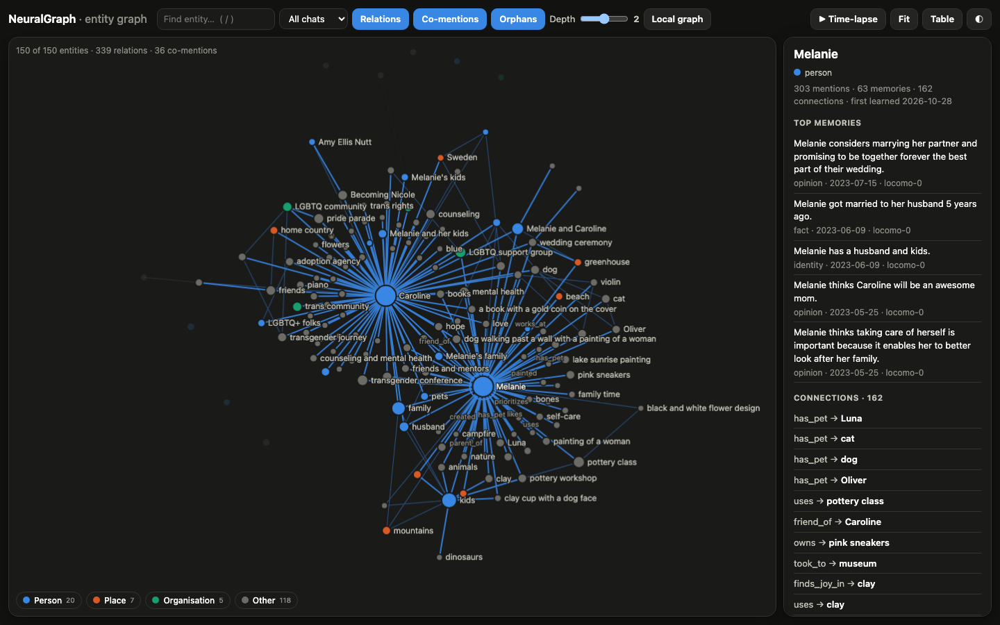

<h1 align="center">NeuralGraph</h1>

<p align="center"><strong>Resonance-driven memory. Adaptive connections. Millisecond recall.</strong></p>
<p align="center">A Rust memory engine built around <strong>computational electron-flow retrieval, wave resonance, and Hebbian plasticity</strong> — paired with a local-first, source-traceable assistant.</p>

<p align="center">
  <a href="LICENSE"></a>
  <a href="https://www.rust-lang.org/"></a>
  <a href="https://modelcontextprotocol.io"></a>
  <a href="#privacy-by-construction"></a>
</p>

<p align="center">
  <a href="#results-at-a-glance">Results</a> ·
  <a href="#quick-start">Install</a> ·
  <a href="#the-electron-engine-implemented-selectable">Electron</a> ·
  <a href="#hebbian-learning-and-wave-resonance">Learning & resonance</a> ·
  <a href="#why-retrieval-can-be-fast">Latency</a> ·
  <a href="#benchmarks">Benchmarks</a> ·
  <a href="#connect-to-claude">MCP setup</a> ·
  <a href="#rest-api-and-dashboard">API</a>
</p>

---

## Results at a glance

**Built for the accuracy–latency frontier, with a neuroscience-inspired retrieval architecture implemented in Rust.** Instead of only locating similar text, the associative engine computes multi-signal resonance and can route activation through a gated memory graph. It implements synthetic charge carriers, excitatory/inhibitory scoring, firing thresholds and Hebbian connection updates. The shipped assistant provides a separately measured, source-grounded low-latency retrieval path.

**Team-reported: 83% LoCoMo accuracy (unpublished).** This number was supplied by the project team but **is not substantiated by the benchmark artifacts currently published in this repository**; the exact question subset, answer model, judge and scoring protocol have not been supplied here. It is **not a verified full-1,540 answer score**. The published answer campaign scored **72.2% on 744 questions**, while all **1,540** were exercised in retrieval-only tests. Similarly, a claim that NeuralGraph is the **fastest** requires a same-workload, same-hardware competitive comparison that is not yet published.

**LoCoMo is a 1,540-question benchmark.** NeuralGraph's research campaign tested retrieval across **all ten conversations (1,540 questions)**. The corresponding **end-to-end answer evaluation covered 744 questions**, not all 1,540. The separate shipped assistant and LongMemEval experiments use their own datasets and protocols.

| Result | Scope | What it actually measures |
|:---|:---|:---|
| **1,540 LoCoMo questions evaluated** | **All 10 conversations**; research-era retrieval experiments | Full-dataset **retrieval-only** evaluation; not 1,540 generated answers. The flat Tesseract research baseline reported **34.9% recall@10 / 48.0% recall@50** under its loose gold-substring metric (including temporal questions, for which the metric is not reliable). |
| **72.2% answer accuracy** | **744 / 1,540 LoCoMo questions**, conversations 1–5 | Research-era local-pairs system, **Gemma-4-e4b reader and lenient Gemma judge**. Conversations 6–10 were not completed in this end-to-end campaign. |
| **75% answer accuracy — Claude Sonnet** | **20 LongMemEval Oracle questions** | Gemma **strict_v2** judge. On the *same 20 questions with identical retrieved contexts*, a Qwen3.8-9B reader scored **55%**. |
| **69% mean answer accuracy — local Qwen3.8-9B** | **150 LongMemEval Oracle questions** (three 50-question draws; 100 held out) | Official LongMemEval judge prompts run using Gemma-4-e4b. Not directly comparable with Sonnet's different 20-question judging protocol. |
| **87.9% evidence@15** | **66 LoCoMo questions**, shipped memory assistant | Whether at least one retrieved memory cited a gold evidence message, **not** answer accuracy. |
| **10 ms p50 / 12 ms p95 retrieval** | **50 LongMemEval Oracle questions**, shipped memory assistant | Includes query embedding; excludes answering. A separate team-reported **17 ms recall** lacks a public same-run artifact. |

**Benchmark integrity:** there is **no verified 1,540-question end-to-end answer accuracy** for either Claude Sonnet or Qwen in the published repository. Do not call 72.2% a full-suite score, or turn the 75% Sonnet and 69% Qwen LongMemEval results into LoCoMo scores. The 1,540-question research suite, the 744-answer run, and the current assistant's 66-question evaluation are **different evaluation paths**.

**Evidence:** [complete LoCoMo research results](research/reports/RESULTS_ALL.md) · [benchmark protocols and scores](docs/BENCHMARKS.md) · [LongMemEval reproduction guide](research/overnight/README.md).

### What NeuralGraph actually is

NeuralGraph has **two distinct layers** in one repository:

| | Installable assistant: `neuralgraph-memory` | NeuralGraph associative engine: `neuralgraph-research` |
|---|---|---|
| **Purpose** | Remember useful facts from conversations and documents, then retrieve attributable evidence | Execute associative graph retrieval through signal resonance, gating, and temporal learning |
| **Retrieval** | SQLite vector similarity + FTS5/BM25, rank fusion, optional graph expansion | Multi-stage graph retrieval; optional Electron propagation, wave alignment, and learned links |
| **Learning** | Asynchronous extraction, provenance, temporal reconciliation and supersession | Hebbian co-activation, long-term potentiation and timing-based plasticity |
| **Status** | Installable Rust binary, MCP tools, CLI, dashboard and API | **Implemented and wired into `NeuralGraphService`: Flash resonance runs by default; Electron is configurable; the multi-stage retriever records Hebbian co-activations.** It is a separate crate, not the installed assistant's default runtime. |

The product is useful today: Claude Code, Claude Desktop, Codex and Cursor can retain memories across sessions, recover citations to the original source, inspect changes, and retract incorrect records. **NeuralGraph already implements associative retrieval.** Its `NeuralGraphService` uses Flash resonance by default, selects Electron flow when enabled, and falls back to the multi-stage neural retriever when neither is selected. The multi-stage path records Hebbian co-activations; temporal STDP and LTP dynamics are also implemented at the service layer. The distinction is **which execution path runs**, not whether these algorithms exist.

```text
SHIPPED ASSISTANT                          RESEARCH ENGINE
conversation / documents                  query + signature
          │                                      │
          ▼                                      ▼
 asynchronous extract + grounding         vector-seeded memories
          │                                      │
          ▼                                      ▼
 SQLite: facts + sources + time          Electron: gated signal flow
          │                                      │
          ▼                                      ▼
 vector + keyword + optional graph        resonance + activation
          │                                      │
          ▼                                      ▼
 rank fusion + evidence cutoff           fired / charged memories
          │                                      │
          ▼                                      ▼
 compact cited context → reader          charge-ranked recall
```

**One rule throughout:** the system must make it easier to get the *right evidence*, not just return a confident-looking answer.
---

## Quick Start

### One command (macOS and Linux)

```bash
curl -fsSL https://raw.githubusercontent.com/anovruzov/NeuralGraph/main/install.sh | sh
```

That is the whole install. The script:

1. Downloads the prebuilt binary for your machine from the latest release and verifies
   its SHA-256, so you need no compiler and no Rust. If there is no prebuilt binary for
   your machine, it installs what a source build needs (the Xcode command-line tools on
   macOS, Rust via rustup) and compiles instead.
2. Puts `neuralgraph-memory` in `~/.local/bin` and adds that folder to your `PATH`.
3. Starts the [setup wizard](#setup-wizard-recommended). If no model server is running, the
   wizard offers to install [Ollama](https://ollama.com) for you and download the models.

You need about 8 GB of RAM for a 7B-class model. The memory server has been observed to idle around 12 MB in the documented environment; memory and database size grow with workload. Read the script before piping it to `sh`:
[`install.sh`](install.sh).

Options are environment variables, for example
`curl -fsSL …/install.sh | NEURALGRAPH_NO_SETUP=1 sh` installs without starting the wizard.
The script's header lists all of them.

### Everyday commands

```bash
neuralgraph-memory open            # the web app in your browser (starts it if it is not running)
neuralgraph-memory open chat       # straight to a page: chat, memories, import, graph, models, settings
neuralgraph-memory chat            # ask your memory questions in the terminal
neuralgraph-memory chat "what cameras do I own?"   # one question, one answer
```

### Updating

You run the install command once. After that:

```bash
neuralgraph-memory update          # or: Settings → General → Update now in the web app
neuralgraph-memory update --check  # only say whether a newer version exists
```

`update` downloads the latest release for your machine, checks its SHA-256, replaces the
program, and restarts the dashboard in place with your settings. It also stops copies that
Claude Code or Claude Desktop started before the update, so they cannot keep learning with the
old version's rules; restart those apps to reconnect them. The web app shows *Update available*
when a newer release exists. That check asks GitHub for the latest version number and happens
only while the web app is open or when you run `update`.

### Prerequisites for building yourself

- **[Rust](https://rustup.rs) 1.89+** and a C compiler (SQLite is compiled into the binary) — or use the
  [container image](#deployment)
- **[Ollama](https://ollama.com)** or **[LM Studio](https://lmstudio.ai)** — optional for a first run (`--fake-llm`)

### 60 seconds, no model required

```bash
git clone https://github.com/anovruzov/NeuralGraph.git
cd NeuralGraph
cargo run --release --example chat_memory_live_demo -- --fake-llm
```

`--fake-llm` runs the entire extraction and retrieval pipeline with a deterministic
stand-in, so you can see the machinery work before downloading a single weight.

### Setup wizard (recommended)

The installer runs this for you. From a clone:

```bash
cargo install --locked --path crates/neuralgraph-memory
neuralgraph-memory setup
```

One command does the rest:

1. Finds LM Studio or Ollama and lists their models. If neither is running, it offers to
   install Ollama. If the recommended models are missing, it offers to download them.
2. Sends one test prompt and one test embedding, so you know both models work.
3. Asks your name and where to keep the memory file.
4. Connects **Claude Code**, **Codex**, **Claude Desktop** and **Cursor**. Pick any of the
   ones it finds. Existing configs are merged, never overwritten, and a `.bak` copy is kept.
5. Saves your answers to `~/.neuralgraph/config.json`, then offers to start the server and
   open the dashboard.

`setup` always shows a *Disk and memory* summary: every model it will use, its size, and
whether it is installed or still to download. Before anything is downloaded, it shows what it will fetch and how big it is. Ollama
sizes come straight from Ollama's registry. It also shows your free disk space and how much
RAM the models need, and only downloads after you confirm:

```text
  ⬇ Ready to download
    Chat model  qwen2.5:7b-instruct      4.7 GB
    Embeddings  nomic-embed-text         0.3 GB
    Images      qwen2.5vl:3b             3.2 GB
                total                    8.2 GB
    ✓ disk     101 GB free
    ✓ memory   about 6 GB of your 48 GB while learning
```

Re-run `setup` any time to change an answer. `setup --yes` accepts every default without
asking and connects no tools. Settings resolve as flags > environment variables >
`config.json` > built-in defaults.

### Manual setup with Ollama

```bash
cargo install --locked --path crates/neuralgraph-memory

ollama pull qwen2.5:7b-instruct
ollama pull nomic-embed-text

export LLM_BASE_URL=http://localhost:11434
export LLM_MODEL=qwen2.5:7b-instruct
export EMBED_MODEL=nomic-embed-text

neuralgraph-memory serve --user-name "Your Name"
```

Open **http://127.0.0.1:8765/** — the dashboard shows the queue draining, memories
appearing, tokens saved and a five-axis health grade in real time.

The built-in defaults are for LM Studio. `setup` detects Ollama and saves its settings; the
block above sets them by hand.

| Default | LM Studio (built in) | Ollama (via `setup` or the variables above) |
|---|---|---|
| Chat model | `google/gemma-4-e4b` | `qwen2.5:7b-instruct` |
| Embedding model | `text-embedding-nomic-embed-text-v1.5` | `nomic-embed-text` |
| Model endpoint | `http://127.0.0.1:1234` | `http://localhost:11434` |

| | |
|---|---|
| Database | `~/.neuralgraph/chat_memory.db` |
| Dashboard / API / MCP | `http://127.0.0.1:8765/`, `/api/*`, `/mcp` |

---

## Connect to Claude

The MCP server reports the name `neuralgraph-chat-memory` (protocol/server version 1.0.0); the installed binary is `neuralgraph-memory`. It speaks **stdio** for desktop
clients and **Streamable HTTP** for everything else, negotiating protocol `2025-06-18`,
`2025-03-26` or `2024-11-05`.

### Claude Desktop

`~/Library/Application Support/Claude/claude_desktop_config.json` on macOS,
`%APPDATA%\Claude\claude_desktop_config.json` on Windows:

```json
{
  "mcpServers": {
    "neuralgraph-memory": {
      "command": "/Users/you/.cargo/bin/neuralgraph-memory",
      "args": ["mcp", "--user-name", "Your Name"],
      "env": {
        "LLM_BASE_URL": "http://localhost:11434",
        "LLM_MODEL": "qwen2.5:7b-instruct",
        "EMBED_MODEL": "nomic-embed-text"
      }
    }
  }
}
```

Use the absolute path to the binary (`command -v neuralgraph-memory` prints it) — the client
does not inherit your `PATH`.

### Claude Code

```bash
claude mcp add neuralgraph-memory -- "$(command -v neuralgraph-memory)" mcp --user-name "Your Name"
```

Or, against an already-running HTTP server:

```bash
claude mcp add --transport http neuralgraph-memory http://127.0.0.1:8765/mcp \
  --header "Authorization: Bearer $NEURALGRAPH_MCP_TOKEN"
```

Ask Claude *"what do you remember about me?"* — if `memory_status` comes back, you are wired up.

### Automatic memory in Claude Code

MCP alone only saves a memory when Claude decides to call a tool. `setup` offers two
Claude Code [hooks](https://docs.claude.com/en/docs/claude-code/hooks) that make memory
automatic. They are written to `~/.claude/settings.json`, any hooks you already have are kept,
and a `.bak` copy of the old file is saved.

| Hook | What it does |
|---|---|
| `Stop` | After every reply, queues your prompt and Claude's final answer from the session transcript. Any running `mcp` or `serve` process turns them into memories in the background. Tool calls, tool output, thinking, system reminders and subagents are skipped. Re-reading a transcript never stores anything twice. |
| `UserPromptSubmit` | Before Claude sees a prompt, adds the memories that are semantically close to it (at most 5, similarity 0.665 or higher with nomic-embed-text; `NEURALGRAPH_RECALL_MIN_SIM` changes the bar). Prompts with nothing relevant get nothing added. |

Both hooks run `neuralgraph-memory hook claude-code`, take milliseconds, and never block
Claude Code: if something fails, the hook logs it and steps aside. To turn them off, re-run
`neuralgraph-memory setup` and answer *no* to "Make memory automatic in Claude Code?".

> Full client configuration, transports, tokens and troubleshooting:
> **[Chat Memory User Guide](crates/neuralgraph-memory/README.md)**

---

## What you get

### Ten MCP tools

NeuralGraph offers **seven read-only tools** and **three write tools**. The CLI and HTTP API expose additional entry points to the same memory system.

| Tool | Purpose |
|---|---|
| `memory_search` | Search with subject, time, and kind filters |
| `memory_context` | Produce an evidence-filtered, prompt-sized context block |
| `memory_answer` | Answer from memory using the routed reader, with source-backed context |
| `memory_profile` | Retrieve known information about a subject |
| `memory_related` | Follow memory relationships |
| `memory_entities` | Inspect entities and typed relations |
| `memory_status` | Inspect ingestion, queue, and health |
| `memory_add_message` | Queue a conversation turn for asynchronous extraction |
| `memory_remember` | Write a specified fact immediately |
| `memory_forget` | Retract a memory while preserving the corresponding audit entry |

The MCP server also exposes resources and a recall prompt. See the [full MCP guide](crates/neuralgraph-memory/README.md) for arguments, outputs, and client-specific configuration.

### Why the memory behaves differently

- **Asynchronous, selective extraction.** Recording a turn need not block generation; a background worker decides which information is worth storing.
- **Source grounding.** Extracted memories are checked against their source text before the write is accepted.
- **Time-aware updates.** New observations can supersede old ones without erasing historical context.
- **Worker recovery.** Leases, retries, and commit fencing protect queue processing across worker restarts.
- **Incremental retrieval.** SQLite FTS5 and vector retrieval combine rankings, with optional entity-graph expansion and subject priors.
- **Useful answers, not just matches.** `memory_answer`, `neuralgraph-memory answer`, and `POST /api/answer` use a reader that routes some numerical and temporal questions to a computation-oriented prompt. This is a model-based answer path, not a guarantee of correctness.

**Limits:** retrieval may miss relevant evidence, extraction can omit or misread facts, and the reader can still answer incorrectly. The graph stores relationships and provenance; it does not independently prove that user-supplied statements are true.

---

## For organizations: Mycelic

NeuralGraph is the open-source local memory engine for an assistant. **[Mycelic Labs](https://myceliclabs.com)** is building a broader enterprise intelligence fabric for connecting evidence across teams and systems while preserving control of underlying data at its source. They address different deployment needs; the features documented here are those available in **this repository**.

---

## How it works

```text
    conversation turn
           │
           ▼
  ┌──────────────────┐   cheap, async, debounced — never blocks the chat
  │  message queue   │
  └────────┬─────────┘
           ▼
  ┌──────────────────┐   gate → extract → ground → reconcile
  │ background       │   local model decides what is worth keeping,
  │ worker (leased)  │   and refuses what the source text does not support
  └────────┬─────────┘
           ▼
  ╔══════════════════════════════════════════════════╗
  ║              neural memory graph                 ║
  ║   memories · entities · typed relations          ║
  ║   speakers · provenance · time & supersession    ║
  ║                  (SQLite)                        ║
  ╚════════════════════┬═════════════════════════════╝
                       │
        ┌──────────────┼──────────────┐
        ▼              ▼              ▼
    ┌────────┐    ┌─────────┐    ┌─────────┐
    │ vector │    │ keyword │    │  graph  │
    │ cosine │    │ FTS5    │    │ entity  │
    │        │    │ bm25    │    │ + 1 hop │
    └────┬───┘    └────┬────┘    └────┬────┘
         └─────────────┼──────────────┘
                       ▼
        Reciprocal Rank Fusion  ─ ranks fuse, scores don't
                       ▼
        priors: importance · recency · subject · entity
                       ▼
        evidence floor + relative cutoff
                       ▼
              context block → Claude
```

**Ranks fuse, scores don't.** Channels vote by rank (vector and keyword by default; the graph hop is opt-in), so no single scorer's scale can
dominate. Priors then reweight by importance, mild recency, and whether the query names the
memory's subject or a mentioned entity. Finally a line must earn its place: a keyword or
graph hit, or cosine above the floor — otherwise it does not reach the model's context.

---

## The Electron engine — implemented, selectable

**A search query becomes a signal that travels through memory.** Instead of only sorting passages by embedding distance, NeuralGraph's implemented Electron retriever launches computational *charge carriers* into a weighted memory graph. Each carrier explores relationships, loses or gains effective energy, responds to compatible wave signatures, and contributes to the activation of memories along its route.

This is **not** a physical electron, a quantum computer, or a claim that electrical signals are traveling through the machine. An `Electron` is a Rust struct representing a **bounded search path with state**: charge (+ excitation / − inhibition), energy, phase, frequency, wave signature, current node, hop count, and traversed path.

### From a question to a firing memory

```text
 Question: "Which change preceded the outage?"
                       │
          embed query + wave signature
                       │
                       ▼
             top-20 vector seeds
                       │
                       ▼
          inject one Electron per seed
                       │
                  ┌────┴────┐
                  ▼         ▼
              [alert]    [change]
                  │         │
           gated edges  gated edges        follow strong, permitted links
                  │         │
                  ▼         ▼
            [router]    [approval]          carry query + path history
                  └─────┬───┘
                        ▼
                [incident record]
           excitation − inhibition
                        │
                resonance × charge
                        │
             crosses firing threshold?
                  yes / no
                   │
                   ▼
        ranked fired + charged memories
```

*Illustrative graph, not an experimental output or an assertion that the algorithm proves causality.*

**The algorithm, in six moves:**

1. **Seed.** Run vector search to identify up to **20** entry memories. Inject a positive-charge Electron into each, carrying the query's numerical signal signature.
2. **Gate.** At each hop, evaluate typed edges through their gates (temporal, semantic, entity, causal, hierarchy, co-activation). Take at most the **eight highest-gated outgoing edges** per carrier; edges with a gate value ≤ 0.05 are ignored.
3. **Propagate.** Energy is scaled by the absolute edge weight, decay, gate value, and target fairness weighting. The edge sign can reverse charge; a conduction-delay calculation advances a synthetic phase. Each new carrier also blends its current signature with the node it leaves (**70% previous / 30% node**).
4. **Resonate.** Compare the arriving signature with the destination memory's signal dimensions. Positive alignment can amplify arriving energy up to **3×**, opposition can dampen it toward **0.3×**, and missing/near-zero signatures are neutral. This is inexpensive vector arithmetic, not an LLM call at every hop.
5. **Fire or suppress.** Each node collects excitatory and inhibitory energy. Its **net charge** must reach the default **0.5** threshold to fire. A phase-coherence adjustment influences firing strength, after which the node enters a **2-step simulated refractory period**.
6. **Stop and rank.** Carriers stop if energy drops below **0.1** or they reach **five hops**; propagation also stops after at most **50 simulation steps**. Fired memories are ranked by accumulated firing charge, followed when needed by positively charged memories that did not fire.

A carrier's energy progression is approximately:

```text
E_next = E_now × |edge_weight| × 0.95 × edge_gate × target_fairness
signature_next = 0.70 × signature_previous + 0.30 × source_node_signature
node_net_charge = sum(excitatory_resonant_energy) − sum(inhibitory_resonant_energy)
```

The graph acts as a **weighted circuit for evidence discovery**. Strong, relevant routes reinforce an arriving signal; weak, incompatible, or inhibitory routes may fail to activate downstream memories. The output is still evidence *candidates*, not verified conclusions.

**Read the implementation:** [Electron carrier, propagation, resonance and firing](crates/neuralgraph-research/src/retrieval/electron.rs) · [service selection and dispatch](crates/neuralgraph-research/src/retrieval/service.rs) · [edge gates](crates/neuralgraph-research/src/retrieval/gating.rs) · [Rust/Python parity tests](crates/neuralgraph-research/tests/electron.rs).

## Hebbian learning and wave resonance

Electron is one **implemented and configurable** way to traverse NeuralGraph's memory circuit. Its default research-service path instead uses Flash resonance. Another implemented path, the multi-stage neural retriever, writes **Hebbian-style co-activation edges** as memories are retrieved together. The temporal manager implements STDP and LTP decay. These mechanisms are real algorithms in the Rust code, even though they are **not all enabled in the same retrieval mode**.

**Hebbian learning — strengthen repeated associations.** In the *separate multi-stage research retriever*, memories retrieved together can form `CO_ACTIVATION` edges; reactivating those edges strengthens them through long-term potentiation (LTP). By default, a co-activation gate requires at least **two activations** before opening. Temporal edges also have spike-timing-dependent plasticity (STDP), decay, and refractory dynamics. This supports a concrete hypothesis: repeated useful paths might become easier to recover without continuously asking a large model to rediscover the same associations.

**Wave resonance — score relationships in signal space.** Memories and queries can carry nine conceptual dimensions: **entity, temporal, action, relational, state, spatial, causal, emotional, quantitative**. Rather than interpreting these as literal physical frequencies, the research code compares vectors, applies synthetic phase/coherence rules, and boosts or dampens compatible activations. A matching keyword alone need not determine the route through the graph.

**Execution details matter:** Electron propagation **does not itself record co-activation edges**. The multi-stage retriever does; the shared service can apply temporal plasticity after retrieval. By default, the research service selects **Flash resonance** (`use_flash_retriever: true`, `use_electron_retriever: false`). Electron is selected by setting `use_electron_retriever: true` in `NeuralGraphServiceConfig`; the multi-stage retriever runs when both options are disabled. These are selectable research-service code paths, not imaginary hardware, physical electrons, or a claim that every mechanism was active in a published benchmark.

**Explore the code:** [co-activation, LTP, STDP](crates/neuralgraph-research/src/retrieval/temporal.rs) · [multi-stage retriever](crates/neuralgraph-research/src/retrieval/retriever.rs) · [wave-interference scoring](crates/neuralgraph-research/src/retrieval/interference.rs) · [wavefront propagation](crates/neuralgraph-research/src/retrieval/wavefront.rs) · [architecture notes](docs/ARCHITECTURE.md).

## Why retrieval can be fast

The design is simple: **do expensive interpretation at ingestion, keep retrieval mostly numerical, and only send a small amount of selected evidence to the reader.** There are two different latency stories:

### Measured speed: the shipped assistant

- **Work moves off the critical path.** Source-grounded extraction and reconciliation happen asynchronously in a worker. A recall request does not need to re-extract the entire conversation.
- **Local indexed search.** SQLite FTS5/BM25 and vector similarity fetch candidates without a hosted database round trip; optional graph expansion stays inside the memory store.
- **Cheap score fusion.** Reciprocal Rank Fusion combines ranks instead of calling a generative reranker on each candidate. Lightweight importance, recency, entity and subject priors plus evidence thresholds determine what reaches context.
- **Short evidence, not a transcript dump.** The reader sees a compact cited context block rather than every historical message.

**Observed:** **10 ms p50 / 12 ms p95** for retrieval including query embedding on a 50-question LongMemEval Oracle sample. A separately reported **17 ms** recall figure lacks its public raw latency artifact. These figures exclude model answer generation; a separate product-path check reported **3.45 s mean** for retrieval **plus generation**.

### Computational efficiency: the implemented Electron mode

Electron's resonance calculations operate on **small fixed-dimensional signatures**. It begins with a limited vector-search seed set, uses **gates to avoid weak edges**, applies an **energy floor** to stop low-value paths, and caps outgoing branching, hop count, and simulation steps. Each propagation decision is arithmetic over stored graph state; it is **not another LLM inference**.

That makes Electron a plausible **bounded, compute-oriented alternative to repeated model-based graph traversal**. It does *not* establish that Electron is faster than the shipped hybrid retriever: branching can still be costly, the **1 ms step counter is simulation time, not wall-clock latency**, and this repository has **no published same-workload Electron-vs-hybrid latency ablation**. Similarly, there is no ablation attributing published accuracy to Hebbian plasticity or resonance. Those results remain research questions, not performance claims.

**Runtime/benchmark boundary:** the installable `neuralgraph-memory` assistant has its own hybrid retrieval path. The associative `NeuralGraphService` already **executes** Flash resonance and timing dynamics by default, can execute Electron via a switch, and can execute Hebbian co-activation via its multi-stage path. The published **10 ms p50 / 12 ms p95** figure belongs to the installable assistant, **not** a timed Electron run. The [September audit](research/reports/AUDIT.md) found these biological mechanisms were not invoked by that specific LoCoMo campaign. Their existence is implemented; their contribution to the headline benchmarks is **not isolated by an ablation**.

---

## Benchmarks

**Different metrics answer different questions.** NeuralGraph's research engine, its shipped assistant pipeline, and the local answer reader have separate evaluations. The **full 1,540-question LoCoMo suite was used for retrieval-only experiments**; only **744 questions** in that research campaign have an end-to-end answer-accuracy score. Do not interpret the smaller shipped-assistant LoCoMo subset or the LongMemEval reader results as the full LoCoMo score. The following results are documented in [BENCHMARKS.md](docs/BENCHMARKS.md) and the [reproduction guide](research/overnight/README.md).

| Evaluation | Result | What was measured |
|---|---:|---|
| **LoCoMo — full research dataset, retrieval only** | **1,540 / 1,540 questions examined** | All ten conversations; retrieval variants and gold-substring recall metrics (not generated-answer accuracy). The original flat Tesseract baseline measured 34.9% recall@10 and 48.0% recall@50 by its loose metric; temporal gold dates make that metric especially limited. [Full results](research/reports/RESULTS_ALL.md) |
| **LoCoMo — research-era end-to-end answers** | **72.2% on 744 / 1,540** | Local-pairs research system with Gemma-4-e4b reader and lenient Gemma judge; conversations 1–5, remaining conversations not run. This is not the shipped memory assistant's answer score. |
| **LoCoMo — shipped extraction/retrieval pipeline** | **87.9% evidence@15** | Retrieval-only: in 66 questions from conversation 0, sessions 1–8, at least one retrieved memory cites a gold evidence message. Qwen3.8-9B extractor, nomic embeddings; one conversation and one run per configuration |
| **LongMemEval Oracle — retrieval** | **93.5% turn@15** | 50-question stratified sample, seed 1; whether retrieved context cites an answer-bearing source turn, not whether the assistant answers correctly |
| **LongMemEval Oracle — end-to-end answers** | **69% mean judged accuracy** | Three 50-question draws (150 total), local Qwen3.8-9B reader and Gemma-4-e4b using official judge prompts. The 100-question held-out mean was **67%**; the other 50 questions were used in protocol selection |
| **Research retrieval A/B** | **+8.9 points** | A controlled comparison on the same 282 LoCoMo questions, with the same judge; research pipeline, not the shipped assistant's end-to-end result |

**Interpretation matters.** `evidence@15` and `turn@15` are *retrieval* metrics, not LoCoMo answer accuracy. These results do **not** measure a Hebbian/resonance-enabled version of the released assistant, so they cannot be credited to those research mechanisms. The LongMemEval run uses **Oracle**, where evidence sessions are supplied; it does not represent the harder LongMemEval S setting. These local-model, local-judge, partial-sample results must not be compared directly with vendor claims from different datasets, readers, judges, retrieval budgets, or evaluation procedures. The 69% is an observed score; projected frontier-model scores are **not** benchmark results.

### Accuracy at speed

**17 ms recall** is a team-reported measurement supplied after the published evaluation. It is shown here as a reported result, **not** a reproducible leaderboard entry: the test population, hardware, latency statistic (mean/p50/p95), context size, and raw run artifact have not yet been added to this repository. It must not be represented as 17 ms *end-to-end answering* or automatically paired with the 87.9% LoCoMo result.

**Reproduced evaluation context:** the benchmark document records p50 **10 ms** and p95 **12 ms** retrieval on its 50-question LongMemEval Oracle databases, including embedding. A separate 50-question product-path answer check measured a **3.45 s mean** including retrieval and generation. These are different workloads, not a universal service-level guarantee.

**Competitive benchmark standard:** for any claim of “#1 accuracy at speed,” systems must be evaluated on the *same* LoCoMo questions, extraction protocol, answer model, judge, retrieval depth, hardware, and latency statistic. The current repository does **not** establish that ranking or ≥85% **end-to-end answer accuracy**. It does establish the more specific **87.9% evidence@15** on the documented subset; that is the metric presented above.

For protocols, samples, prompts, limitations, negative results, and reproduction commands, start with [docs/BENCHMARKS.md](docs/BENCHMARKS.md). The [overnight reproduction guide](research/overnight/README.md) describes the shipped reader and its held-out evaluation.

---

## Repository layout

```text
crates/neuralgraph-memory/    the assistant: memory server, MCP, worker, store, dashboard
crates/neuralgraph-research/  research code, not used at runtime
demo/                         runnable demos (cargo examples; work with --fake-llm)
deploy/                       Docker, compose and systemd units
docs/                         design docs
research/                     research datasets and artifacts
```

| I want to… | Start here |
|---|---|
| Give Claude persistent memory | [`crates/neuralgraph-memory/README.md`](crates/neuralgraph-memory/README.md) |
| See it work in 60 seconds | [`demo/README.md`](demo/README.md) |
| Deploy it somewhere | [`deploy/`](deploy/) |

---

## CLI

After installation, run `neuralgraph-memory --help` for all options. Frequently used commands:

| Command | Purpose |
|---|---|
| `setup` | Select local models, test the endpoints, and connect MCP clients |
| `open [PAGE]` | Open the dashboard (home, chat, memories, import, graph, models, activity, settings) |
| `chat [QUESTION]` | Ask memory interactively or once; show citations, evidence, and stats |
| `answer "QUESTION"` | Use the routed answer reader, with optional `--today` and `--json` |
| `search "QUERY"` / `context "QUERY"` | Inspect retrieval or print context without asking the reader |
| `remember "FACT"` / `forget MEMORY_ID` | Explicitly save or retract a memory |
| `profile SUBJECT` / `graph [ENTITY]` | Inspect subject knowledge and relations |
| `ingest FILE` / `process` | Import JSONL or LoCoMo data and process the extraction queue |
| `stats` / `maintain` | Inspect health and perform maintenance |
| `pause` / `resume` | Pause or resume model-backed learning |
| `serve` / `mcp` | HTTP dashboard + API + MCP server, or MCP over stdio |
| `update` / `update --check` | Upgrade or check for a new GitHub release |

```bash
neuralgraph-memory remember "I prefer local-first tools" --subject "Your Name"
neuralgraph-memory search "local-first tools"
neuralgraph-memory answer "What tools do I prefer?"
neuralgraph-memory graph --out graph.html
```

Choose a separate database with `--db ~/work.db` or `--db ~/personal.db`. These are separate memory stores; the application does not automatically merge them.

---

## REST API and dashboard

`neuralgraph-memory serve` runs the background worker, the dashboard at **http://127.0.0.1:8765/**, REST endpoints under `/api/*`, and Streamable HTTP MCP at `/mcp`.

The local dashboard is intended for inspecting and controlling the actual stored data, not just looking at aggregate counts.

| Page | Primary use |
|---|---|
| **Home** | Status, memory and entity counts, recent activity, worker and queue health |
| **Chat** | Ask questions; inspect numbered source citations, search evidence, and timing |
| **Memories** | Search, add, edit, retract, archive, and restore memory entries |
| **Import** | Preview and import Claude/ChatGPT exports, Claude Code sessions, notes, PDFs, screenshots, or text |
| **Graph** | Explore entities, typed relations, co-mentions, neighborhoods, and source memories |
| **Models** | See local models, change assignments, load/unload, and download compatible models |
| **Activity** | Review imported chats, extraction queue, and recent work |
| **Settings** | Configure identity, memory location, clients, model endpoints, and updates |

<p align="center">
  
</p>

**Import behavior:** chats use the speaker's own turns as the source of personal memories and retain assistant responses as context; documents are read in smaller sections. Imports show a preview before processing. A vision-capable local model can process screenshots; this may require a separate model download. The resulting facts can still be incomplete or mistaken, so review imported memories before using them for high-stakes decisions.

**Answers with citations:** `POST /api/answer` and `memory_answer` use the routed reader. The ordinary Chat UI can also return a citation-backed answer from retrieved context. Citations show *where an answer came from*, not an external validation of that source.

**Automatic recall:** `setup` can install Claude Code hooks that save conversation content and supply relevant memories before a prompt. MCP alone does not automatically capture every conversation unless the client calls a write tool or a hook/integration is enabled. Existing client settings are backed up by the setup process.

More precise API payloads, supported imports, modes, and operating limits are documented in the [user guide](crates/neuralgraph-memory/README.md).

---

## Configuration

| Variable | Default | Purpose |
|---|---|---|
| `NEURALGRAPH_MEMORY_DB` | `~/.neuralgraph/chat_memory.db` | Database path |
| `NEURALGRAPH_USER_NAME` | unset | Display name for speaker `user` (same as `--user-name`) |
| `NEURALGRAPH_CONFIG` | `~/.neuralgraph/config.json` | Where `setup` saves its answers |
| `NEURALGRAPH_MCP_TOKEN` | unset | Bearer token required on `/mcp` |
| `NEURALGRAPH_API_TOKEN` | unset | Bearer token required on `/api/*` |
| `LLM_BASE_URL` | `http://127.0.0.1:1234` (LM Studio) | Model server URL; port 11434 selects the Ollama API |
| `LLM_MODEL` | `google/gemma-4-e4b` | Generation model |
| `EMBED_MODEL` | `text-embedding-nomic-embed-text-v1.5` | Embedding model |
| `OLLAMA_NUM_PARALLEL` | — | Match `--parallel` when using Ollama |
| `LLM_NO_THINK_PREFILL` | unset | `1` always switches reasoning off with an empty think block. Rarely needed: a model seen reasoning anyway gets this automatically |

Command-line flags override environment variables, which override the answers `setup`
saved in `~/.neuralgraph/config.json`.

---

## Privacy by construction

For normal use, memory lives in local SQLite and the chat and embedding requests go to the **model endpoint you configure**, typically Ollama or LM Studio on the same machine. The app does not require a hosted NeuralGraph account or send product telemetry. **Installation and version checks contact GitHub**; a remotely configured model endpoint may send prompts or memory content to that endpoint.

- **Local storage is not encryption.** SQLite files, journals, exports, and backups must be protected with appropriate file permissions and disk encryption.
- **Loopback is the safe default.** `serve` binds to `127.0.0.1` unless you change it.
- **Tokens are not on by default.** When exposing HTTP beyond localhost, configure `NEURALGRAPH_MCP_TOKEN` and `NEURALGRAPH_API_TOKEN`, restrict network access, and terminate TLS in a reverse proxy.
- **Retraction is not secure erasure.** `memory_forget` preserves an audit record; imported originals, backups, application transcripts, and any previously supplied context may still contain the information.
- **One store is not a multi-tenant service.** Run separate processes/databases for separate people. There is no built-in user-level isolation.

Review [SECURITY.md](SECURITY.md) before remote deployment or storing sensitive information.

---

## Deployment

Container with the memory server and Ollama, with volumes for both:

```bash
docker compose -f deploy/chat_memory/docker-compose.yml up
```

Or build just the server:

```bash
docker build -f deploy/chat_memory/Dockerfile -t neuralgraph-memory .
```

**Prebuilt binaries.** Pushing a tag such as `v1.1.0` runs `.github/workflows/release.yml`.
It builds `neuralgraph-memory` for macOS (Apple silicon and Intel) and Linux (x86_64 and
arm64), then attaches each `.tar.gz` and its `.sha256` to the GitHub release. `install.sh`
downloads those files.

For an always-on laptop or mini-PC, `deploy/chat_memory/neuralgraph-memory.service` runs
`serve` as a systemd user service beside a local Ollama. One binary, one SQLite file, no
other services.

---

## Tests

```bash
cargo test -p neuralgraph-memory
```

Every test uses a temporary database and a deterministic fake model, so the suite needs no
GPU and no network. Covered: idempotent ingestion, per-chat ordering with cross-chat
parallelism, backoff and dead-lettering, restart recovery of expired leases, lease-fenced
commits, reconciliation and the "older observation never wins" rule, grounding rejections,
embedding outages, retrieval channels and filters, superseded handling, the token ledger
and grade, and the MCP protocol over both stdio and HTTP.

---

## Troubleshooting

| Symptom | Fix |
|---|---|
| Model server unreachable | Start LM Studio's server (Developer → Start Server) or `ollama serve`; the Models page shows which server NeuralGraph talks to |
| Model not found | Models page → Download, or `neuralgraph-memory setup` |
| Build errors | Rust 1.89+ (`rustup update`) and a C compiler (`xcode-select --install`, `build-essential`) |
| MCP client cannot connect | Run `neuralgraph-memory mcp` in a terminal first; then check the **absolute** binary path in your client config |
| Extraction seems stuck | Open the dashboard — the queue and worker mood tell you immediately |
| Concurrency does nothing | Raise `OLLAMA_NUM_PARALLEL` to match `--parallel`, or requests just queue inside Ollama |

More, client by client, in the
**[Chat Memory User Guide](crates/neuralgraph-memory/README.md#14-troubleshooting)**.

---

## Documentation

| Document | What is in it |
|---|---|
| **[Chat Memory User Guide](crates/neuralgraph-memory/README.md)** | Install, transports, every tool, every flag |
| **[Chat Memory Design](docs/CHAT_MEMORY.md)** | Why extraction is gated, how channels fuse, how commits are fenced |
| **[Security](SECURITY.md)** | What the server enforces, what it does not, and how to report a vulnerability |
| **[Contributing](CONTRIBUTING.md)** | Setup, tests and code style |

---

## Project status

Actively developed. Interfaces, configuration and storage formats may still change.

Current work: retrieval quality, temporal reasoning, query routing, cross-chat memory,
attribution, latency, and local-first agent integrations.

Contributions are welcome — issues and pull requests both.

---

## License

[MIT](LICENSE) © NeuralGraph contributors.

<div align="center">

**Your conversations. Your machine. Your memory.**

</div>
