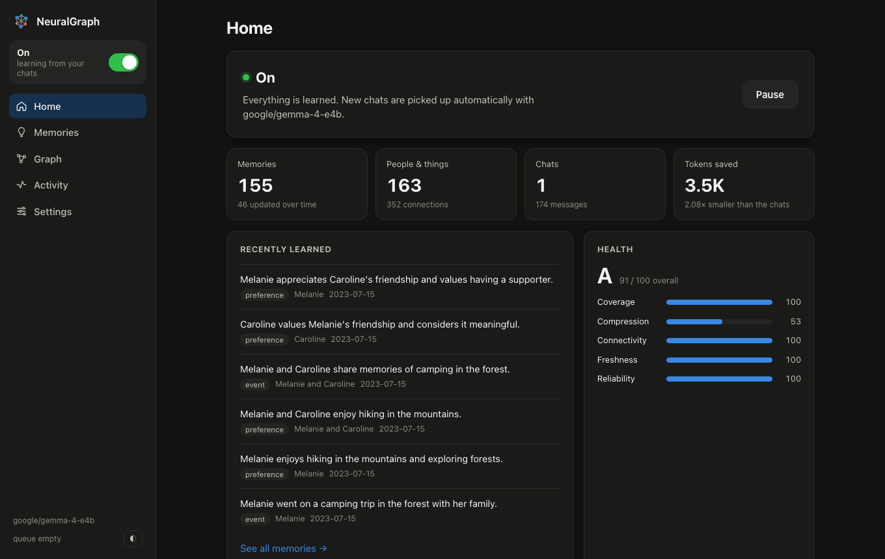
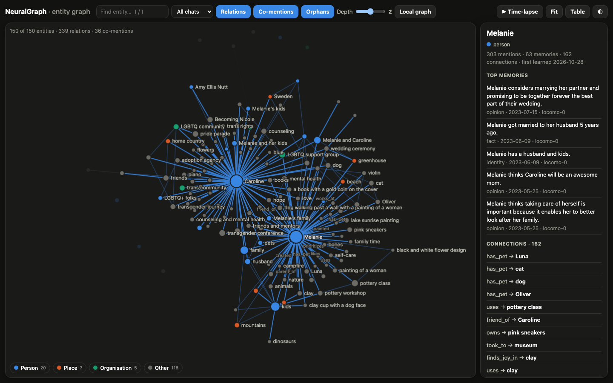

<h1 align="center">NeuralGraph</h1>

<p align="center">
  <strong>Persistent graph memory for Claude and AI agents — local-first, yours.</strong>
</p>

<p align="center">
  <a href="LICENSE"></a>
  <a href="https://www.rust-lang.org/"></a>
  <a href="https://modelcontextprotocol.io"></a>
  <a href="#privacy-by-construction"></a>
</p>

<p align="center">
  <a href="#quick-start">Quick Start</a> ·
  <a href="#connect-to-claude">Connect to Claude</a> ·
  <a href="#what-you-get">Features</a> ·
  <a href="#how-it-works">Architecture</a> ·
  <a href="#cli">CLI</a> ·
  <a href="#rest-api-and-dashboard">REST API</a>
</p>

---

NeuralGraph gives Claude and any MCP-capable agent memory that survives the end of a
conversation. Every turn becomes structured memories, entities and typed relations in a
local knowledge graph; retrieval fuses vector and keyword channels by rank, with an entity-graph channel you can opt into; the whole thing runs on
your machine against a local model.

**Free and open source** — no cloud accounts, no API keys, no subscriptions, no telemetry.

What makes it different from a vector store with a nice wrapper:

| | NeuralGraph |
|---|---|
| **Retrieval** | Vector + BM25 fused by Reciprocal Rank Fusion, plus subject and entity priors — not cosine similarity alone |
| **Time** | Facts supersede facts. "Where did Ali live in March?" returns the *March* answer, not today's |
| **Speakers** | Per-agent routing: a question about Nurman searches Nurman's memories |
| **Ownership** | One binary, one SQLite file. Delete the file and the memory is gone — really gone |

---

## Quick Start

### One command (macOS and Linux)

```bash
curl -fsSL https://raw.githubusercontent.com/anovruzov/NeuralGraph/main/install.sh | sh
```

That is the whole install. The script:

1. Downloads the prebuilt binary for your machine from the latest release and verifies
   its SHA-256, so you need no compiler and no Rust. If there is no prebuilt binary for
   your machine, it installs what a source build needs (the Xcode command-line tools on
   macOS, Rust via rustup) and compiles instead.
2. Puts `neuralgraph-memory` in `~/.local/bin` and adds that folder to your `PATH`.
3. Starts the [setup wizard](#setup-wizard-recommended). If no model server is running, the
   wizard offers to install [Ollama](https://ollama.com) for you and download the models.

You need about 8 GB of RAM for a 7B-class model. The memory server itself idles at
about 12 MB, and the database is tiny. Read the script before piping it to `sh`:
[`install.sh`](install.sh).

Options are environment variables, for example
`curl -fsSL …/install.sh | NEURALGRAPH_NO_SETUP=1 sh` installs without starting the wizard.
The script's header lists all of them.

### Updating

You run the install command once. After that:

```bash
neuralgraph-memory update          # or: Settings → General → Update now in the web app
neuralgraph-memory update --check  # only say whether a newer version exists
```

`update` downloads the latest release for your machine, checks its SHA-256, replaces the
program, and restarts the dashboard in place with your settings. It also stops copies that
Claude Code or Claude Desktop started before the update, so they cannot keep learning with the
old version's rules; restart those apps to reconnect them. The web app shows *Update available*
when a newer release exists. That check asks GitHub for the latest version number and happens
only while the web app is open or when you run `update`.

### Prerequisites for building yourself

- **[Rust](https://rustup.rs) 1.89+** and a C compiler (SQLite is compiled into the binary) — or use the
  [container image](#deployment)
- **[Ollama](https://ollama.com)** or **[LM Studio](https://lmstudio.ai)** — optional for a first run (`--fake-llm`)

### 60 seconds, no model required

```bash
git clone https://github.com/anovruzov/NeuralGraph.git
cd NeuralGraph
cargo run --release --example chat_memory_live_demo -- --fake-llm
```

`--fake-llm` runs the entire extraction and retrieval pipeline with a deterministic
stand-in, so you can see the machinery work before downloading a single weight.

### Setup wizard (recommended)

The installer runs this for you. From a clone:

```bash
cargo install --locked --path crates/neuralgraph-memory
neuralgraph-memory setup
```

One command does the rest:

1. Finds LM Studio or Ollama and lists their models. If neither is running, it offers to
   install Ollama. If the recommended models are missing, it offers to download them.
2. Sends one test prompt and one test embedding, so you know both models work.
3. Asks your name and where to keep the memory file.
4. Connects **Claude Code**, **Codex**, **Claude Desktop** and **Cursor**. Pick any of the
   ones it finds. Existing configs are merged, never overwritten, and a `.bak` copy is kept.
5. Saves your answers to `~/.neuralgraph/config.json`, then offers to start the server and
   open the dashboard.

`setup` always shows a *Disk and memory* summary: every model it will use, its size, and
whether it is installed or still to download. Before anything is downloaded, it shows what it will fetch and how big it is. Ollama
sizes come straight from Ollama's registry. It also shows your free disk space and how much
RAM the models need, and only downloads after you confirm:

```text
  ⬇ Ready to download
    Chat model  qwen2.5:7b-instruct      4.7 GB
    Embeddings  nomic-embed-text         0.3 GB
    Images      qwen2.5vl:3b             3.2 GB
                total                    8.2 GB
    ✓ disk     101 GB free
    ✓ memory   about 6 GB of your 48 GB while learning
```

Re-run `setup` any time to change an answer. `setup --yes` accepts every default without
asking and connects no tools. Settings resolve as flags > environment variables >
`config.json` > built-in defaults.

### Manual setup with Ollama

```bash
cargo install --locked --path crates/neuralgraph-memory

ollama pull qwen2.5:7b-instruct
ollama pull nomic-embed-text

export LLM_BASE_URL=http://localhost:11434
export LLM_MODEL=qwen2.5:7b-instruct
export EMBED_MODEL=nomic-embed-text

neuralgraph-memory serve --user-name "Your Name"
```

Open **http://127.0.0.1:8765/** — the dashboard shows the queue draining, memories
appearing, tokens saved and a five-axis health grade in real time.

| Default | Value |
|---|---|
| Generation model | `qwen2.5:7b-instruct` (Ollama) |
| Embedding model | `nomic-embed-text` |
| Model endpoint | `http://localhost:11434` |
| Database | `~/.neuralgraph/chat_memory.db` |
| Dashboard / API / MCP | `http://127.0.0.1:8765/`, `/api/*`, `/mcp` |

---

## Connect to Claude

The MCP server is `neuralgraph-chat-memory` (v1.0.0). It speaks **stdio** for desktop
clients and **Streamable HTTP** for everything else, negotiating protocol `2025-06-18`,
`2025-03-26` or `2024-11-05`.

### Claude Desktop

`~/Library/Application Support/Claude/claude_desktop_config.json` on macOS,
`%APPDATA%\Claude\claude_desktop_config.json` on Windows:

```json
{
  "mcpServers": {
    "neuralgraph-memory": {
      "command": "/Users/you/.cargo/bin/neuralgraph-memory",
      "args": ["mcp", "--user-name", "Your Name"],
      "env": {
        "LLM_BASE_URL": "http://localhost:11434",
        "LLM_MODEL": "qwen2.5:7b-instruct",
        "EMBED_MODEL": "nomic-embed-text"
      }
    }
  }
}
```

Use the absolute path to the binary (`command -v neuralgraph-memory` prints it) — the client
does not inherit your `PATH`.

### Claude Code

```bash
claude mcp add neuralgraph-memory -- "$(command -v neuralgraph-memory)" mcp --user-name "Your Name"
```

Or, against an already-running HTTP server:

```bash
claude mcp add --transport http neuralgraph-memory http://127.0.0.1:8765/mcp \
  --header "Authorization: Bearer $NEURALGRAPH_MCP_TOKEN"
```

Ask Claude *"what do you remember about me?"* — if `memory_status` comes back, you are wired up.

### Automatic memory in Claude Code

MCP alone only saves a memory when Claude decides to call a tool. `setup` offers two
Claude Code [hooks](https://docs.claude.com/en/docs/claude-code/hooks) that make memory
automatic. They are written to `~/.claude/settings.json`, any hooks you already have are kept,
and a `.bak` copy of the old file is saved.

| Hook | What it does |
|---|---|
| `Stop` | After every reply, queues your prompt and Claude's final answer from the session transcript. Any running `mcp` or `serve` process turns them into memories in the background. Tool calls, tool output, thinking, system reminders and subagents are skipped. Re-reading a transcript never stores anything twice. |
| `UserPromptSubmit` | Before Claude sees a prompt, adds the memories that are semantically close to it (at most 5, similarity 0.57 or higher with nomic-embed-text; `NEURALGRAPH_RECALL_MIN_SIM` changes the bar). Prompts with nothing relevant get nothing added. |

Both hooks run `neuralgraph-memory hook claude-code`, take milliseconds, and never block
Claude Code: if something fails, the hook logs it and steps aside. To turn them off, re-run
`neuralgraph-memory setup` and answer *no* to "Make memory automatic in Claude Code?".

> Full client configuration, transports, tokens and troubleshooting:
> **[Chat Memory User Guide](crates/neuralgraph-memory/README.md)**

---

## What you get

### Nine MCP tools

**Read** — always safe, never mutate:

| Tool | What it does |
|---|---|
| `memory_search` | Hybrid search across every memory, with subject/time/kind filters |
| `memory_context` | A prompt-ready context block, evidence-floored and size-capped |
| `memory_profile` | Everything known about a person or entity |
| `memory_related` | Memories connected to a given one through the graph |
| `memory_entities` | The entity graph and its typed relations |
| `memory_status` | Queue depth, worker health, tokens saved, grade |

**Write** — the only three calls that change anything:

| Tool | What it does |
|---|---|
| `memory_add_message` | Record a turn. Returns immediately; extraction happens in the background |
| `memory_remember` | Store a fact immediately, write-through |
| `memory_forget` | Retract a memory, keeping an audit entry |

Plus three MCP resources and a `recall` prompt.

### The properties behind them

- **Asynchronous extraction.** Recording a turn never blocks the conversation. A debounce
  window pairs a user turn with its reply so they are extracted as one unit.
- **Gated extraction.** Not every message contains a fact worth keeping. The worker decides
  before it spends a token.
- **Grounded writes.** A memory that is not supported by the source text is rejected rather
  than stored.
- **Time-aware supersession.** The observation with the latest *source* time wins, whatever
  order chats were ingested in. History is kept and shown as `superseded by …`.
- **Fenced commits.** Work is leased; a worker that dies mid-job has its lease expire and its
  job retried, never double-committed. Restart recovery is tested.
- **Incremental indexes.** The vector index is refreshed with rows written since the last
  query, and filters are masks.
- **Safe model swaps.** Change your embedding model and old rows keep answering queries of
  their own dimension until maintenance re-embeds them.

---

## For organizations: Mycelic

NeuralGraph is memory for one assistant, on one machine. Its enterprise sibling,
**[Mycelic](https://github.com/PNurmanM/MycelicLabs)**, rolls many agents' private memories up through an
organization's hierarchy as a self-hosted service.

---

## How it works

```text
    conversation turn
           │
           ▼
  ┌──────────────────┐   cheap, async, debounced — never blocks the chat
  │  message queue   │
  └────────┬─────────┘
           ▼
  ┌──────────────────┐   gate → extract → ground → reconcile
  │ background       │   local model decides what is worth keeping,
  │ worker (leased)  │   and refuses what the source text does not support
  └────────┬─────────┘
           ▼
  ╔══════════════════════════════════════════════════╗
  ║              neural memory graph                 ║
  ║   memories · entities · typed relations          ║
  ║   speakers · provenance · time & supersession    ║
  ║                  (SQLite)                        ║
  ╚════════════════════┬═════════════════════════════╝
                       │
        ┌──────────────┼──────────────┐
        ▼              ▼              ▼
    ┌────────┐    ┌─────────┐    ┌─────────┐
    │ vector │    │ keyword │    │  graph  │
    │ cosine │    │ FTS5    │    │ entity  │
    │        │    │ bm25    │    │ + 1 hop │
    └────┬───┘    └────┬────┘    └────┬────┘
         └─────────────┼──────────────┘
                       ▼
        Reciprocal Rank Fusion  ─ ranks fuse, scores don't
                       ▼
        priors: importance · recency · subject · entity
                       ▼
        evidence floor + relative cutoff
                       ▼
              context block → Claude
```

**Ranks fuse, scores don't.** Channels vote by rank (vector and keyword by default; the graph hop is opt-in), so no single scorer's scale can
dominate. Priors then reweight by importance, mild recency, and whether the query names the
memory's subject or a mentioned entity. Finally a line must earn its place: a keyword or
graph hit, or cosine above the floor — otherwise it does not reach the model's context.

---

## Repository layout

```text
crates/neuralgraph-memory/    the assistant: memory server, MCP, worker, store, dashboard
crates/neuralgraph-research/  research code, not used at runtime
demo/                         runnable demos (cargo examples; work with --fake-llm)
deploy/                       Docker, compose and systemd units
docs/                         design docs
research/                     research datasets and artifacts
```

| I want to… | Start here |
|---|---|
| Give Claude persistent memory | [`crates/neuralgraph-memory/README.md`](crates/neuralgraph-memory/README.md) |
| See it work in 60 seconds | [`demo/README.md`](demo/README.md) |
| Deploy it somewhere | [`deploy/`](deploy/) |

---

## CLI

Everything the server does, available from a terminal. All commands are
`neuralgraph-memory <command>`.

| Command | What it does |
|---|---|
| `update` | Download the latest version, replace the program, restart the dashboard (`--check`, `--version TAG`) |
| `setup` | First-run wizard: model server, model tests, your name, connect Claude Code / Codex / Claude Desktop / Cursor (`--yes` for defaults) |
| `serve` | Worker + dashboard + REST API + MCP over HTTP |
| `mcp` | Worker + MCP over stdio |
| `ingest FILE` | Import a JSONL chat log, or LoCoMo JSON with `--locomo` |
| `process` | Drain the extraction queue in the foreground |
| `search QUERY` | Search memories (`-k`, `--subject`, `--history`, `--json`) |
| `context QUERY` | Print a prompt-ready context block (`-k`, `--max-chars`) |
| `profile SUBJECT` | What is known about a subject (`--json`) |
| `graph [ENTITY]` | Entity graph as a terminal tree (`--depth`, `--hubs`, `--chat-id`, `--json`), or `--out graph.html` for an offline explorer |
| `stats` | Counts, queue, tokens saved, grade |
| `remember TEXT` | Store a memory now (`--subject`, `--kind`, `--when`) |
| `forget MEMORY_ID` | Retract a memory (`--reason`) |
| `maintain` | Run one maintenance pass |

```bash
neuralgraph-memory remember "Ali moved to Berlin" --subject Ali
neuralgraph-memory search "where does Ali live" --history
neuralgraph-memory stats
```

Common flags on every command: `--db`, `--model`, `--base-url`, `--embed-model`,
`--parallel`, `--workers`, `--batch-size`, `--debounce`, `--user-name`,
`--no-extract-assistant`, `--fake-llm`, `-v`.

Separate databases are just separate paths — `--db ~/work.db` and `--db ~/personal.db`
share nothing.

---

## REST API and dashboard

`serve` runs four things in one process: the worker, MCP at `/mcp`, a REST API under
`/api/*`, and the web app at `/`. Everything can be controlled from the web app:

| Section | What it holds |
|---|---|
| **Home** | Whether NeuralGraph is on, learning or paused; memories, entities, chats and tokens saved; recently learned memories; a health grade |
| **Memories** | *Browse* (filter, forget), *Ask* (an answer written only from your memories, with its sources), *Add* (remember something now) |
| **Graph** | The entity graph explorer (below) |
| **Activity** | *Chats* read, the *Queue* of messages still to learn, and a *Log* of recent work |
| **Settings** | *General* (name, on/off, theme), *Models* (pick the server and models, test them, switch live), *Connections* (connect Claude Code, Codex, Claude Desktop or Cursor, and turn on automatic memory), *Advanced* (files, endpoints, CLI equivalents) |

<div align="center">
  
</div>

**Import.** The *Import* section brings in what other tools already know about you:

| Source | How |
|---|---|
| Claude.ai | Settings → Privacy → *Export data*, then drop the `.zip` |
| ChatGPT | Settings → Data controls → *Export data*, then drop the `.zip` |
| Claude Code | *Find sessions* reads every past session in `~/.claude/projects` |
| Notes and PDFs | `.md`, `.txt`, `.pdf`, or a `.zip` of a notes folder such as an Obsidian vault |
| Screenshots | `.png`, `.jpg` and friends, read by a vision model first |
| Paste | Any text |

Every import shows a preview first: what it found, a checkbox for each item, and an estimate
of the time. Re-importing the same file stores nothing twice. The two kinds of import are
learned differently:

- **Chats** (Claude.ai, ChatGPT, Claude Code) are read 20 messages at a time, and only what
  *you* said becomes a memory. The assistant's turns are context: its long answers are
  explanations and status reports, not facts about you.
- **Documents** (notes, PDFs, screenshots, pasted text) are split into sections of about 900
  characters at their headings. Each section is read on its own with "record every fact"
  rules, several sections in parallel. A 13 KB profile becomes about 90 memories in roughly
  7 minutes with Gemma 4 E4B on an Apple-silicon laptop. Uploads stay on your machine. The endpoint takes files up to 512 MB and refuses
requests from other websites.

**Screenshots without overloading your machine.** When the chat model can see (LM Studio's
recommended Gemma 4 E4B can), it reads screenshots itself and nothing else is loaded. When it
cannot (Ollama's Qwen 2.5 7B), a small vision model reads them, and the two are swapped
instead of loaded together. Learning is held, the chat model is unloaded, the vision model
reads every image of the import, then it is unloaded and the chat model returns. The chat
model is reloaded only if it was loaded before. Choose the image model under
*Settings → Models*.

**Fewer, better memories.** Chats recorded by the Claude Code hooks are coding sessions, so they
are learned differently from ordinary chats. Each turn waits ten minutes, and every new turn
pushes the earlier ones back, so a stretch of work is read in one go, 20 messages at a time,
instead of two at a time. The model is told to keep only lasting facts: your preferences,
decisions, projects, people and setup. It drops progress updates, test results and release
status. On a real 30-message session this cut 38 memories to 10, and 15 model calls to 2.
*Activity → Chats → Re-learn* re-reads an older chat with today's rules.

Memories rated below 0.6 are **minor**. *Memories → Browse* hides them unless you ask to see
them. Once a day, minor memories nobody has recalled for two weeks are archived. *Clean up
now* merges near-duplicates and archives every minor memory nobody has recalled, at any age.
Archived memories leave search and the graph, and *Archived → Restore* brings any of them back.

**On/off switch.** The switch at the top of the sidebar pauses NeuralGraph and unloads its
chat and embedding models from LM Studio or Ollama, so their RAM is free for something else.
Other models you have loaded are left alone. While paused, no NeuralGraph process calls a
model: chats are still saved and queue up, search falls back to keyword matching, and
*Remember* still works. Switching it back on loads both models again and learns whatever
queued up. The same switch is `neuralgraph-memory pause` and `neuralgraph-memory resume`.

Settings changes made in the web app apply immediately and are saved to
`~/.neuralgraph/config.json`. Requests that change settings are accepted only as JSON from the
page's own origin, so other websites cannot change them.

### Entity graph

The dashboard embeds a graph explorer (also at `/graph` full screen). Entities are nodes,
sized by mentions and coloured by type. Typed relations and co-mentions (two entities named
in the same memory) are the edges.

- **Local graph:** click an entity to highlight its neighbourhood to a chosen depth (1–3),
  or press *Local graph* to show only that neighbourhood. The side panel lists the
  entity's top memories and every connection.
- **Filters:** toggle relations, co-mentions, orphans and each type in the legend, find an
  entity with <kbd>/</kbd>, or scope to one chat. *Table* shows the same data as a list.
- **Time-lapse:** replays the graph forming in the order memories were learned.
- **Live:** new entities pulse in as the worker extracts them; signals travel along edges
  while it is busy.
- **Deep links:** `/graph?focus=Caroline&depth=2&local=1` opens the explorer on one entity.

<div align="center">
  
</div>

```bash
neuralgraph-memory graph Melanie --depth 2    # ASCII tree in the terminal
neuralgraph-memory graph --out graph.html     # self-contained explorer, opens without a server
```

---

## Configuration

| Variable | Default | Purpose |
|---|---|---|
| `NEURALGRAPH_MEMORY_DB` | `~/.neuralgraph/chat_memory.db` | Database path |
| `NEURALGRAPH_USER_NAME` | unset | Display name for speaker `user` (same as `--user-name`) |
| `NEURALGRAPH_CONFIG` | `~/.neuralgraph/config.json` | Where `setup` saves its answers |
| `NEURALGRAPH_MCP_TOKEN` | unset | Bearer token required on `/mcp` |
| `NEURALGRAPH_API_TOKEN` | unset | Bearer token required on `/api/*` |
| `LLM_BASE_URL` | `http://127.0.0.1:1234` (LM Studio) | Model server URL; port 11434 selects the Ollama API |
| `LLM_MODEL` | `google/gemma-4-e4b` | Generation model |
| `EMBED_MODEL` | `text-embedding-nomic-embed-text-v1.5` | Embedding model |
| `OLLAMA_NUM_PARALLEL` | — | Match `--parallel` when using Ollama |
| `LLM_NO_THINK_PREFILL` | unset | `1` for Qwen builds that ignore `reasoning_effort` and return empty replies |

Command-line flags override environment variables, which override the answers `setup`
saved in `~/.neuralgraph/config.json`.

---

## Privacy by construction

NeuralGraph is local-first by design, not by policy:

- **Local SQLite** — one file, on your disk, that you can inspect, back up or delete.
- **Local models** — generation and embeddings run on your machine via Ollama or LM Studio.
- **Local transport** — stdio, or HTTP bound to `127.0.0.1` by default.
- **No telemetry.** Nothing phones home. There is nothing to phone home to.

Hardening if you expose it beyond localhost: bearer tokens on `/mcp` and `/api/*`
(`--mcp-token`, `--api-token`), a CORS allow-list, `Host` validation and CSRF protection
(a state-changing request from a foreign `Origin` is refused). Binding to anything other
than `127.0.0.1` makes the server reachable by other machines — read
[Security](crates/neuralgraph-memory/README.md#12-security) before you do.

You remain responsible for the machine and the applications that can reach the database
and the MCP server.

---

## Deployment

Container with the memory server and Ollama, with volumes for both:

```bash
docker compose -f deploy/chat_memory/docker-compose.yml up
```

Or build just the server:

```bash
docker build -f deploy/chat_memory/Dockerfile -t neuralgraph-memory .
```

**Prebuilt binaries.** Pushing a tag such as `v1.1.0` runs `.github/workflows/release.yml`.
It builds `neuralgraph-memory` for macOS (Apple silicon and Intel) and Linux (x86_64 and
arm64), then attaches each `.tar.gz` and its `.sha256` to the GitHub release. `install.sh`
downloads those files.

For an always-on laptop or mini-PC, `deploy/chat_memory/neuralgraph-memory.service` runs
`serve` as a systemd user service beside a local Ollama. One binary, one SQLite file, no
other services.

---

## Tests

```bash
cargo test -p neuralgraph-memory
```

Every test uses a temporary database and a deterministic fake model, so the suite needs no
GPU and no network. Covered: idempotent ingestion, per-chat ordering with cross-chat
parallelism, backoff and dead-lettering, restart recovery of expired leases, lease-fenced
commits, reconciliation and the "older observation never wins" rule, grounding rejections,
embedding outages, retrieval channels and filters, superseded handling, the token ledger
and grade, and the MCP protocol over both stdio and HTTP.

---

## Troubleshooting

| Symptom | Fix |
|---|---|
| Model server unreachable | `ollama serve`; confirm `LLM_BASE_URL` (default `http://localhost:11434`) |
| Model not found | `ollama list`, then `ollama pull qwen2.5:7b-instruct` / `nomic-embed-text` |
| Build errors | Rust 1.89+ (`rustup update`) and a C compiler (`xcode-select --install`, `build-essential`) |
| MCP client cannot connect | Run `neuralgraph-memory mcp` in a terminal first; then check the **absolute** binary path in your client config |
| Extraction seems stuck | Open the dashboard — the queue and worker mood tell you immediately |
| Concurrency does nothing | Raise `OLLAMA_NUM_PARALLEL` to match `--parallel`, or requests just queue inside Ollama |

More, client by client, in the
**[Chat Memory User Guide](crates/neuralgraph-memory/README.md#14-troubleshooting)**.

---

## Documentation

| Document | What is in it |
|---|---|
| **[Chat Memory User Guide](crates/neuralgraph-memory/README.md)** | Install, transports, every tool, every flag |
| **[Chat Memory Design](docs/CHAT_MEMORY.md)** | Why extraction is gated, how channels fuse, how commits are fenced |
| **[Security](SECURITY.md)** | What the server enforces, what it does not, and how to report a vulnerability |
| **[Contributing](CONTRIBUTING.md)** | Setup, tests and code style |

---

## Project status

Actively developed. Interfaces, configuration and storage formats may still change.

Current work: retrieval quality, temporal reasoning, query routing, cross-chat memory,
attribution, latency, and local-first agent integrations.

Contributions are welcome — issues and pull requests both.

---

## License

[MIT](LICENSE) © NeuralGraph contributors.

<div align="center">

**Your conversations. Your machine. Your memory.**

</div>
