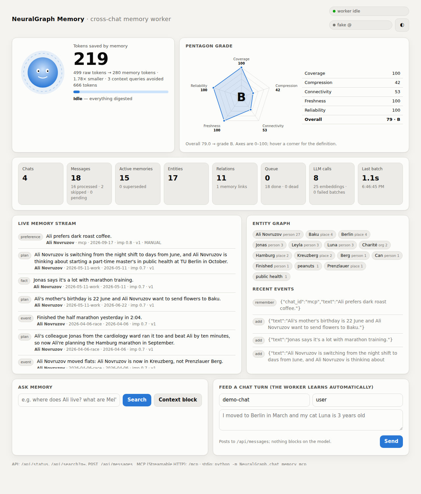

<h1 align="center">NeuralGraph</h1>

<p align="center">
  <strong>Persistent graph memory for Claude and AI agents — local-first, yours.</strong>
</p>

<p align="center">
  <a href="LICENSE"></a>
  <a href="https://www.rust-lang.org/"></a>
  <a href="https://modelcontextprotocol.io"></a>
  <a href="#privacy-by-construction"></a>
</p>

<p align="center">
  <a href="#quick-start">Quick Start</a> ·
  <a href="#connect-to-claude">Connect to Claude</a> ·
  <a href="#what-you-get">Features</a> ·
  <a href="#how-it-works">Architecture</a> ·
  <a href="#cli">CLI</a> ·
  <a href="#rest-api-and-dashboard">REST API</a>
</p>

---

NeuralGraph gives Claude and any MCP-capable agent memory that survives the end of a
conversation. Every turn becomes structured memories, entities and typed relations in a
local knowledge graph; retrieval fuses vector and keyword channels by rank, with an entity-graph channel you can opt into; the whole thing runs on
your machine against a local model.

**Free and open source** — no cloud accounts, no API keys, no subscriptions, no telemetry.

What makes it different from a vector store with a nice wrapper:

| | NeuralGraph |
|---|---|
| **Retrieval** | Vector + BM25 fused by Reciprocal Rank Fusion, plus subject and entity priors — not cosine similarity alone |
| **Time** | Facts supersede facts. "Where did Ali live in March?" returns the *March* answer, not today's |
| **Speakers** | Per-agent routing: a question about Nurman searches Nurman's memories |
| **Ownership** | One binary, one SQLite file. Delete the file and the memory is gone — really gone |

---

## Quick Start

### Prerequisites

- **[Rust](https://rustup.rs) 1.89+** and a C compiler (SQLite is compiled into the binary) — or use the
  [container image](#deployment)
- **[Ollama](https://ollama.com)** or **[LM Studio](https://lmstudio.ai)** — optional for a first run (`--fake-llm`)
- ~8 GB RAM for a 7B-class model. The memory server idles at ~12 MB; the database is tiny.

### 60 seconds, no model required

```bash
git clone https://github.com/anovruzov/NeuralGraph.git
cd NeuralGraph
cargo run --release --example chat_memory_live_demo -- --fake-llm
```

`--fake-llm` runs the entire extraction and retrieval pipeline with a deterministic
stand-in, so you can see the machinery work before downloading a single weight.

### With a real local model

```bash
cargo install --locked --path crates/neuralgraph-memory

ollama pull qwen2.5:7b-instruct
ollama pull nomic-embed-text

export LLM_BASE_URL=http://localhost:11434
export LLM_MODEL=qwen2.5:7b-instruct
export EMBED_MODEL=nomic-embed-text

neuralgraph-memory serve --user-name "Your Name"
```

Open **http://127.0.0.1:8765/** — the dashboard shows the queue draining, memories
appearing, tokens saved and a five-axis health grade in real time.

| Default | Value |
|---|---|
| Generation model | `qwen2.5:7b-instruct` (Ollama) |
| Embedding model | `nomic-embed-text` |
| Model endpoint | `http://localhost:11434` |
| Database | `~/.neuralgraph/chat_memory.db` |
| Dashboard / API / MCP | `http://127.0.0.1:8765/`, `/api/*`, `/mcp` |

---

## Connect to Claude

The MCP server is `neuralgraph-chat-memory` (v1.0.0). It speaks **stdio** for desktop
clients and **Streamable HTTP** for everything else, negotiating protocol `2025-06-18`,
`2025-03-26` or `2024-11-05`.

### Claude Desktop

`~/Library/Application Support/Claude/claude_desktop_config.json` on macOS,
`%APPDATA%\Claude\claude_desktop_config.json` on Windows:

```json
{
  "mcpServers": {
    "neuralgraph-memory": {
      "command": "/Users/you/.cargo/bin/neuralgraph-memory",
      "args": ["mcp", "--user-name", "Your Name"],
      "env": {
        "LLM_BASE_URL": "http://localhost:11434",
        "LLM_MODEL": "qwen2.5:7b-instruct",
        "EMBED_MODEL": "nomic-embed-text"
      }
    }
  }
}
```

Use the absolute path to the binary (`command -v neuralgraph-memory` prints it) — the client
does not inherit your `PATH`.

### Claude Code

```bash
claude mcp add neuralgraph-memory -- "$(command -v neuralgraph-memory)" mcp --user-name "Your Name"
```

Or, against an already-running HTTP server:

```bash
claude mcp add --transport http neuralgraph-memory http://127.0.0.1:8765/mcp \
  --header "Authorization: Bearer $NEURALGRAPH_MCP_TOKEN"
```

Ask Claude *"what do you remember about me?"* — if `memory_status` comes back, you are wired up.

> Full client configuration, transports, tokens and troubleshooting:
> **[Chat Memory User Guide](crates/neuralgraph-memory/README.md)**

---

## What you get

### Nine MCP tools

**Read** — always safe, never mutate:

| Tool | What it does |
|---|---|
| `memory_search` | Hybrid search across every memory, with subject/time/kind filters |
| `memory_context` | A prompt-ready context block, evidence-floored and size-capped |
| `memory_profile` | Everything known about a person or entity |
| `memory_related` | Memories connected to a given one through the graph |
| `memory_entities` | The entity graph and its typed relations |
| `memory_status` | Queue depth, worker health, tokens saved, grade |

**Write** — the only three calls that change anything:

| Tool | What it does |
|---|---|
| `memory_add_message` | Record a turn. Returns immediately; extraction happens in the background |
| `memory_remember` | Store a fact immediately, write-through |
| `memory_forget` | Retract a memory, keeping an audit entry |

Plus three MCP resources and a `recall` prompt.

### The properties behind them

- **Asynchronous extraction.** Recording a turn never blocks the conversation. A debounce
  window pairs a user turn with its reply so they are extracted as one unit.
- **Gated extraction.** Not every message contains a fact worth keeping. The worker decides
  before it spends a token.
- **Grounded writes.** A memory that is not supported by the source text is rejected rather
  than stored.
- **Time-aware supersession.** The observation with the latest *source* time wins, whatever
  order chats were ingested in. History is kept and shown as `superseded by …`.
- **Fenced commits.** Work is leased; a worker that dies mid-job has its lease expire and its
  job retried, never double-committed. Restart recovery is tested.
- **Incremental indexes.** The vector index is refreshed with rows written since the last
  query, and filters are masks.
- **Safe model swaps.** Change your embedding model and old rows keep answering queries of
  their own dimension until maintenance re-embeds them.

---

## For organizations: Mycelic

NeuralGraph is memory for one assistant, on one machine. Its enterprise sibling,
**[Mycelic](https://github.com/PNurmanM/MycelicLabs)**, rolls many agents' private memories up through an
organization's hierarchy as a self-hosted service.

---

## How it works

```text
    conversation turn
           │
           ▼
  ┌──────────────────┐   cheap, async, debounced — never blocks the chat
  │  message queue   │
  └────────┬─────────┘
           ▼
  ┌──────────────────┐   gate → extract → ground → reconcile
  │ background       │   local model decides what is worth keeping,
  │ worker (leased)  │   and refuses what the source text does not support
  └────────┬─────────┘
           ▼
  ╔══════════════════════════════════════════════════╗
  ║              neural memory graph                 ║
  ║   memories · entities · typed relations          ║
  ║   speakers · provenance · time & supersession    ║
  ║                  (SQLite)                        ║
  ╚════════════════════┬═════════════════════════════╝
                       │
        ┌──────────────┼──────────────┐
        ▼              ▼              ▼
    ┌────────┐    ┌─────────┐    ┌─────────┐
    │ vector │    │ keyword │    │  graph  │
    │ cosine │    │ FTS5    │    │ entity  │
    │        │    │ bm25    │    │ + 1 hop │
    └────┬───┘    └────┬────┘    └────┬────┘
         └─────────────┼──────────────┘
                       ▼
        Reciprocal Rank Fusion  ─ ranks fuse, scores don't
                       ▼
        priors: importance · recency · subject · entity
                       ▼
        evidence floor + relative cutoff
                       ▼
              context block → Claude
```

**Ranks fuse, scores don't.** Channels vote by rank (vector and keyword by default; the graph hop is opt-in), so no single scorer's scale can
dominate. Priors then reweight by importance, mild recency, and whether the query names the
memory's subject or a mentioned entity. Finally a line must earn its place: a keyword or
graph hit, or cosine above the floor — otherwise it does not reach the model's context.

---

## Repository layout

```text
crates/neuralgraph-memory/    the assistant: memory server, MCP, worker, store, dashboard
crates/neuralgraph-research/  research code, not used at runtime
demo/                         runnable demos (cargo examples; work with --fake-llm)
deploy/                       Docker, compose and systemd units
docs/                         design docs
research/                     research datasets and artifacts
```

| I want to… | Start here |
|---|---|
| Give Claude persistent memory | [`crates/neuralgraph-memory/README.md`](crates/neuralgraph-memory/README.md) |
| See it work in 60 seconds | [`demo/README.md`](demo/README.md) |
| Deploy it somewhere | [`deploy/`](deploy/) |

---

## CLI

Everything the server does, available from a terminal. All commands are
`neuralgraph-memory <command>`.

| Command | What it does |
|---|---|
| `serve` | Worker + dashboard + REST API + MCP over HTTP |
| `mcp` | Worker + MCP over stdio |
| `ingest FILE` | Import a JSONL chat log, or LoCoMo JSON with `--locomo` |
| `process` | Drain the extraction queue in the foreground |
| `search QUERY` | Search memories (`-k`, `--subject`, `--history`, `--json`) |
| `context QUERY` | Print a prompt-ready context block (`-k`, `--max-chars`) |
| `profile SUBJECT` | What is known about a subject (`--json`) |
| `stats` | Counts, queue, tokens saved, grade |
| `remember TEXT` | Store a memory now (`--subject`, `--kind`, `--when`) |
| `forget MEMORY_ID` | Retract a memory (`--reason`) |
| `maintain` | Run one maintenance pass |

```bash
neuralgraph-memory remember "Ali moved to Berlin" --subject Ali
neuralgraph-memory search "where does Ali live" --history
neuralgraph-memory stats
```

Common flags on every command: `--db`, `--model`, `--base-url`, `--embed-model`,
`--parallel`, `--workers`, `--batch-size`, `--debounce`, `--user-name`,
`--no-extract-assistant`, `--fake-llm`, `-v`.

Separate databases are just separate paths — `--db ~/work.db` and `--db ~/personal.db`
share nothing.

---

## REST API and dashboard

`serve` runs four things in one process: the worker, MCP at `/mcp`, a REST API under
`/api/*`, and a live dashboard at `/`.

The dashboard polls `/api/status` every two seconds and shows an avatar that pulses while
the worker is busy, the **tokens saved** figure (raw chat tokens digested minus the tokens
of the memories that replace them), and a **pentagon grade** across five axes — coverage,
compression, connectivity, freshness and reliability.

<div align="center">
  
</div>

The live memory stream shows each memory as it is extracted, with its kind, subject,
source chat, date and importance; the entity graph beside it shows what has been linked
to what. You can search memory and feed it a chat turn straight from the page.

---

## Configuration

| Variable | Default | Purpose |
|---|---|---|
| `NEURALGRAPH_MEMORY_DB` | `~/.neuralgraph/chat_memory.db` | Database path |
| `NEURALGRAPH_MCP_TOKEN` | unset | Bearer token required on `/mcp` |
| `NEURALGRAPH_API_TOKEN` | unset | Bearer token required on `/api/*` |
| `LLM_BASE_URL` | `http://127.0.0.1:1234` (LM Studio) | Model server URL; port 11434 selects the Ollama API |
| `LLM_MODEL` | `google/gemma-4-e4b` | Generation model |
| `EMBED_MODEL` | `text-embedding-nomic-embed-text-v1.5` | Embedding model |
| `OLLAMA_NUM_PARALLEL` | — | Match `--parallel` when using Ollama |
| `LLM_NO_THINK_PREFILL` | unset | `1` for Qwen builds that ignore `reasoning_effort` and return empty replies |

Command-line flags override environment variables.

---

## Privacy by construction

NeuralGraph is local-first by design, not by policy:

- **Local SQLite** — one file, on your disk, that you can inspect, back up or delete.
- **Local models** — generation and embeddings run on your machine via Ollama or LM Studio.
- **Local transport** — stdio, or HTTP bound to `127.0.0.1` by default.
- **No telemetry.** Nothing phones home. There is nothing to phone home to.

Hardening if you expose it beyond localhost: bearer tokens on `/mcp` and `/api/*`
(`--mcp-token`, `--api-token`), a CORS allow-list, `Host` validation and CSRF protection
(a state-changing request from a foreign `Origin` is refused). Binding to anything other
than `127.0.0.1` makes the server reachable by other machines — read
[Security](crates/neuralgraph-memory/README.md#12-security) before you do.

You remain responsible for the machine and the applications that can reach the database
and the MCP server.

---

## Deployment

Container with the memory server and Ollama, with volumes for both:

```bash
docker compose -f deploy/chat_memory/docker-compose.yml up
```

Or build just the server:

```bash
docker build -f deploy/chat_memory/Dockerfile -t neuralgraph-memory .
```

For an always-on laptop or mini-PC, `deploy/chat_memory/neuralgraph-memory.service` runs
`serve` as a systemd user service beside a local Ollama. One binary, one SQLite file, no
other services.

---

## Tests

```bash
cargo test -p neuralgraph-memory
```

Every test uses a temporary database and a deterministic fake model, so the suite needs no
GPU and no network. Covered: idempotent ingestion, per-chat ordering with cross-chat
parallelism, backoff and dead-lettering, restart recovery of expired leases, lease-fenced
commits, reconciliation and the "older observation never wins" rule, grounding rejections,
embedding outages, retrieval channels and filters, superseded handling, the token ledger
and grade, and the MCP protocol over both stdio and HTTP.

---

## Troubleshooting

| Symptom | Fix |
|---|---|
| Model server unreachable | `ollama serve`; confirm `LLM_BASE_URL` (default `http://localhost:11434`) |
| Model not found | `ollama list`, then `ollama pull qwen2.5:7b-instruct` / `nomic-embed-text` |
| Build errors | Rust 1.89+ (`rustup update`) and a C compiler (`xcode-select --install`, `build-essential`) |
| MCP client cannot connect | Run `neuralgraph-memory mcp` in a terminal first; then check the **absolute** binary path in your client config |
| Extraction seems stuck | Open the dashboard — the queue and worker mood tell you immediately |
| Concurrency does nothing | Raise `OLLAMA_NUM_PARALLEL` to match `--parallel`, or requests just queue inside Ollama |

More, client by client, in the
**[Chat Memory User Guide](crates/neuralgraph-memory/README.md#14-troubleshooting)**.

---

## Documentation

| Document | What is in it |
|---|---|
| **[Chat Memory User Guide](crates/neuralgraph-memory/README.md)** | Install, transports, every tool, every flag |
| **[Chat Memory Design](docs/CHAT_MEMORY.md)** | Why extraction is gated, how channels fuse, how commits are fenced |
| **[Security](SECURITY.md)** | What the server enforces, what it does not, and how to report a vulnerability |
| **[Contributing](CONTRIBUTING.md)** | Setup, tests and code style |

---

## Project status

Actively developed. Interfaces, configuration and storage formats may still change.

Current work: retrieval quality, temporal reasoning, query routing, cross-chat memory,
attribution, latency, and local-first agent integrations.

Contributions are welcome — issues and pull requests both.

---

## License

[MIT](LICENSE) © NeuralGraph contributors.

<div align="center">

**Your conversations. Your machine. Your memory.**

</div>
