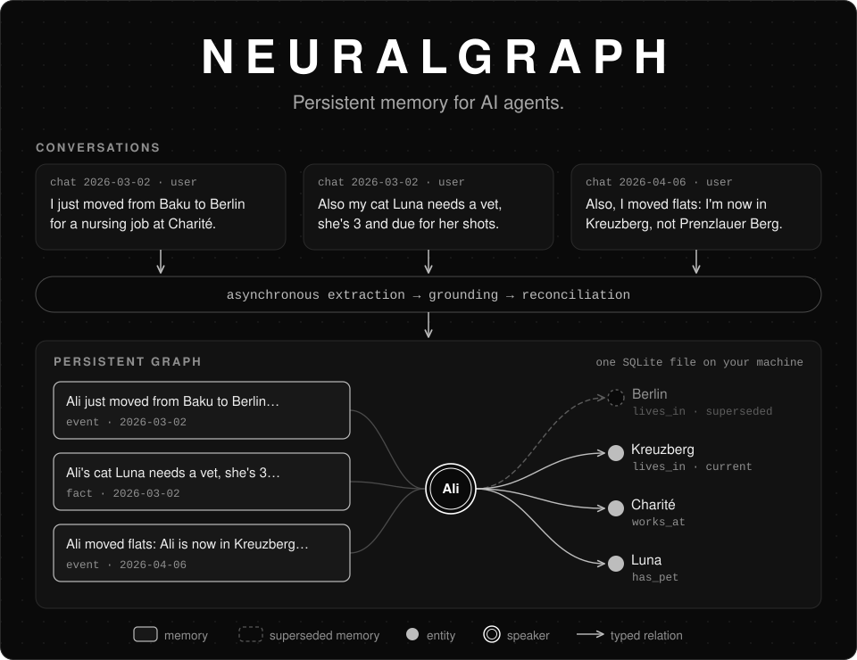
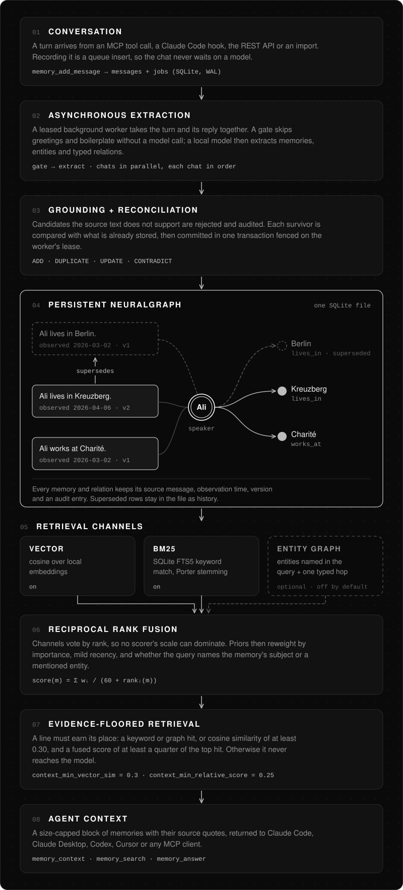
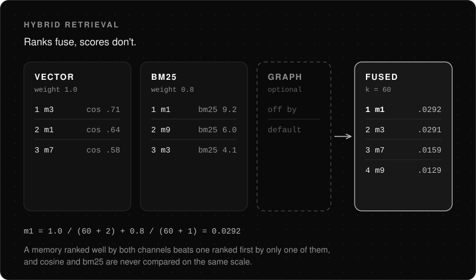
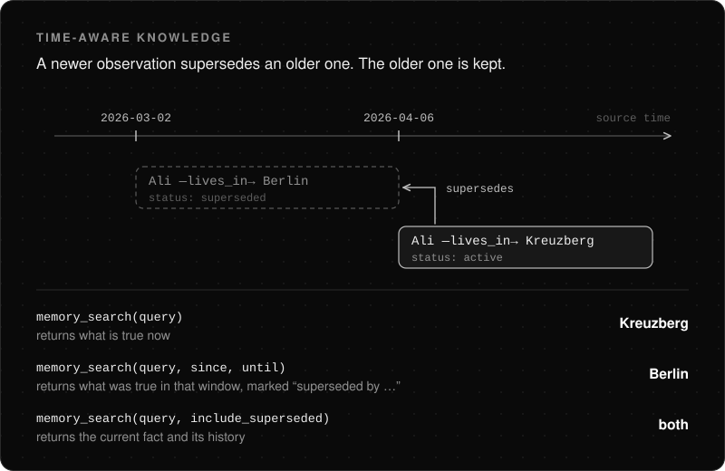
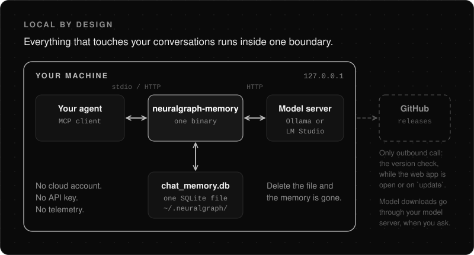
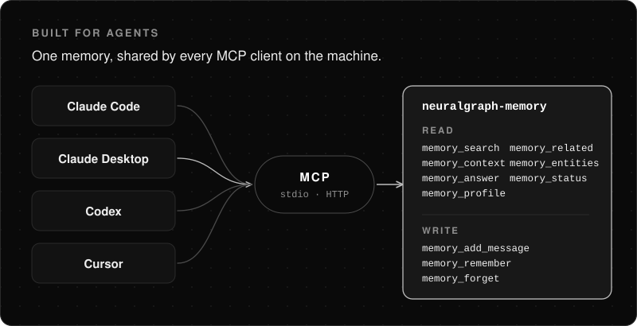
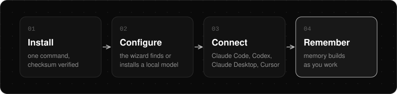

<p align="center">
  
</p>

<h3 align="center">Your conversations. Your machine. Your memory.</h3>

<p align="center">
  <a href="https://www.rust-lang.org/"></a>
  <a href="LICENSE"></a>
  <a href="https://modelcontextprotocol.io"></a>
  <a href="#local-by-design"></a>
</p>

<p align="center">
  <a href="#quick-start"><b>Get Started</b></a> ·
  <a href="#architecture"><b>Architecture</b></a> ·
  <a href="#dashboard"><b>Dashboard</b></a> ·
  <a href="#integrations"><b>Integrations</b></a> ·
  <a href="#documentation"><b>Documentation</b></a>
</p>

<br>

## Agents forget. NeuralGraph remembers.

NeuralGraph gives Claude and any other MCP-compatible agent persistent, structured memory that
survives the end of a conversation. A background worker turns each turn into memories, entities and
typed relations, rejects anything the source text does not support, and stores it all in one SQLite
file on your machine. Agents recall it through hybrid retrieval, with the evidence attached. One
binary, a local model, no cloud account.

<br>

## Architecture

<p align="center">
  
</p>

Writing never blocks the chat: `memory_add_message` is a queue insert, and a leased worker does the
model work later. Every decision for a batch lands in one SQLite transaction fenced on the worker's
lease, so a crash leaves nothing half-written and a retry can never double-commit. Reading fuses
channels by rank, then keeps only lines that clear an evidence floor. Full design:
[`docs/CHAT_MEMORY.md`](docs/CHAT_MEMORY.md).

<br>

## Dashboard

`neuralgraph-memory open` starts the local web app. These are real screenshots of it, running on a
LoCoMo conversation.

<table>
  <tr>
    <td width="50%" valign="top">
      
      <p><b>Home.</b> Whether it is learning, what it learned last, tokens saved and a five-axis health grade.</p>
    </td>
    <td width="50%" valign="top">
      
      <p><b>Graph explorer.</b> Entities and typed relations, a local view to depth 3, time-lapse replay and a table view.</p>
    </td>
  </tr>
</table>

The app also has **Chat** (answers that cite the memories they used, with evidence one click away),
**Memories** (browse, edit, forget, restore), **Import** (Claude.ai and ChatGPT exports, Claude Code
sessions, notes, PDFs, screenshots), **Models** and **Activity**. Tour:
[docs/GUIDE.md → REST API and dashboard](docs/GUIDE.md#rest-api-and-dashboard).

<br>

## Core capabilities

### Memory that persists

Conversations become durable, structured memory: one self-contained sentence per memory, with a
kind (fact, preference, event, plan, relationship, opinion, identity, task), a subject, a speaker, an
event time, an importance score and the messages it came from. A cheap gate drops greetings and
boilerplate before any model call, and the extractor is told to keep few, lasting facts.

### Retrieval that understands context

<p align="center">
  
</p>

Vector search over local embeddings and SQLite FTS5 BM25 run on every query and are fused by
Reciprocal Rank Fusion. The entity-graph channel (entities named in the query, plus one typed hop) is
available but **off by default**: on LoCoMo it cost up to 9 points of evidence recall by pulling
related non-answers into context. Turn it on with `channels = "VKG"`. Subject and entity priors route
a question about a person to that person's memories.

### Time-aware knowledge

<p align="center">
  
</p>

Facts can be superseded without destroying history. The observation with the latest *source* time
wins, whatever order chats were imported in, so bulk-importing old chats after new ones is safe. A
question with a time window gets the answer that was true then.

### Local by design

<p align="center">
  
</p>

Local models through Ollama or LM Studio, local SQLite storage, transport bound to `127.0.0.1`, no
telemetry, no required cloud account. The memory server idles at about 12 MB; a 7B-class model needs
about 8 GB of RAM. Exposing it beyond localhost? Read [SECURITY.md](SECURITY.md) first.

### Built for agents

<p align="center">
  
</p>

Ten MCP tools, three resources and a `recall` prompt, over stdio or Streamable HTTP. Read tools never
mutate. Only `memory_add_message`, `memory_remember` and `memory_forget` change anything, and a
forget keeps an audit entry.

<br>

## What it gives you

| | What it means for you | How |
|---|---|---|
| **Local-first storage** | Inspect, back up or delete your memory like any file | One SQLite file, `~/.neuralgraph/chat_memory.db` |
| **Structured relationships** | Ask about a person and get that person, not a lookalike | Entity registry with aliases; typed triples such as `works_at`, `has_pet` |
| **Time-aware supersession** | Updated facts replace old ones; history stays queryable | Single-valued predicates supersede by source time; `since` / `until` windows |
| **Per-agent and per-subject memory** | Questions route to the right speaker's memories | Every memory has a canonical `subject` and `speaker` |
| **Grounded extraction** | Fewer invented facts in your agent's context | Candidates the source text does not support are rejected and audited |
| **Hybrid retrieval** | Exact names and paraphrases both hit | Vector + BM25 fused by RRF; entity graph optional |
| **MCP interoperability** | One memory shared by every agent you use | stdio and Streamable HTTP; protocol `2025-06-18`, `2025-03-26`, `2024-11-05` |
| **Evidence and provenance** | See exactly why a memory was recalled | Source messages, observation time, version and audit log for every row |

<br>

## Quick start

```bash
curl -fsSL https://raw.githubusercontent.com/anovruzov/NeuralGraph/main/install.sh | sh
```

The script downloads the prebuilt binary for macOS or Linux and verifies its SHA-256 (or builds from
source if there is none for your machine), puts `neuralgraph-memory` in `~/.local/bin`, then runs the
setup wizard. The wizard finds or installs a local model server, tests both models, and connects
Claude Code, Codex, Claude Desktop and Cursor. Existing configs are merged, with a `.bak` kept.

Prefer to read it first:

```bash
curl -fsSL https://raw.githubusercontent.com/anovruzov/NeuralGraph/main/install.sh -o install.sh
less install.sh
sh install.sh
```

<p align="center">
  
</p>

Then:

```bash
neuralgraph-memory open      # the web app
neuralgraph-memory chat      # ask your memory in the terminal
neuralgraph-memory update    # later: fetch the latest release
```

<details>
<summary><b>No model yet? Run the whole pipeline in 60 seconds</b></summary>

```bash
git clone https://github.com/anovruzov/NeuralGraph.git
cd NeuralGraph
cargo run --release --example chat_memory_live_demo -- --fake-llm
```

`--fake-llm` runs extraction and retrieval with a deterministic stand-in model. Then open
http://127.0.0.1:8765/.
</details>

<details>
<summary><b>Build from source, manual Ollama setup, Docker</b></summary>

Requires Rust 1.89+ and a C compiler (SQLite is compiled in).

```bash
cargo install --locked --path crates/neuralgraph-memory
neuralgraph-memory setup
```

Manual Ollama setup, the LM Studio defaults, Docker Compose and the systemd unit are in
[docs/GUIDE.md → Quick Start](docs/GUIDE.md#quick-start) and
[→ Deployment](docs/GUIDE.md#deployment).
</details>

<br>

## Working example

Real output from the shipped binary, run on the five sample chats in
[`demo/data/sample_chats.jsonl`](demo/data/sample_chats.jsonl) with the deterministic stand-in
model. In those chats Ali first moves to Berlin, then later says *"I'm now in Kreuzberg, not
Prenzlauer Berg."*

```console
$ neuralgraph-memory ingest demo/data/sample_chats.jsonl --fake-llm --user-name Ali
ingested 18 messages into ~/.neuralgraph/chat_memory.db; queue: {'queued': 18}

$ neuralgraph-memory process --fake-llm --user-name Ali
10 batches, 16 messages processed, 2 skipped, 14 memories added, 0 superseded, 0 duplicates, 12 relations, 0 failures

$ neuralgraph-memory graph Ali --depth 1 --fake-llm --user-name Ali
Ali [person] · 15 connections
├─ moved_from → Baku [place]
├─ works_at → Charité [org]
├─ colleague_of → Jonas [person]
├─ lives_in → Kreuzberg [place]
├─ sibling_of → Leyla [person]
├─ allergic_to → peanuts
├─ diet → vegetarian
└─ …

$ neuralgraph-memory context "is Ali allergic to anything" -k 1 --fake-llm --user-name Ali
Relevant long-term memories (most relevant first):
- [preference] Ali is vegetarian and allergic to peanuts. (from chat 2026-03-19-food, 2026-03-19)
    > user (2026-03-19): "Quick one: I'm vegetarian and allergic to peanuts. Can you suggest a high-protein dinner I can cook in 20 minutes? My sister Leyla is visiting from Baku tonight."
Raw messages that match the question:
- (user, 2026-03-02) "Hi! I'm Ali. I just moved from Baku to Berlin last month for a nursing job at Charité, and I'm trying to get organised."
```

The earlier `lives_in → Berlin` relation is still in the database with status `superseded`; only the
current one is shown. The graph listing is trimmed with `…`. The two skipped messages were *"Perfect, thanks!"* and
*"ok thanks, good night"*, dropped by the gate before any model call. With a real model, the same
memory is available in any later conversation through `memory_context`.

<br>

## Integrations

| Agent | How it connects |
|---|---|
| **Claude Code** | `setup` registers the MCP server and offers two hooks: `Stop` queues each finished turn, `UserPromptSubmit` adds relevant memories before Claude sees a prompt |
| **Claude Desktop** | stdio MCP server in `claude_desktop_config.json` |
| **Codex** | registered by `setup` |
| **Cursor** | `~/.cursor/mcp.json` |
| **Any MCP client** | Streamable HTTP at `http://127.0.0.1:8765/mcp`, bearer token optional |

Manual setup:

```bash
claude mcp add neuralgraph-memory -- "$(command -v neuralgraph-memory)" mcp --user-name "Your Name"
```

Ask *"what do you remember about me?"*. If `memory_status` comes back, you are connected. Every client
config, transport and token: [docs/GUIDE.md → Connect to Claude](docs/GUIDE.md#connect-to-claude).

<br>

## Technical overview

| Layer | Implementation |
|---|---|
| Language | Rust, one binary (`crates/neuralgraph-memory`) |
| Storage | SQLite (WAL) with FTS5: memories, entities, aliases, relations, memory links, provenance, job queue, audit log |
| Worker | Tokio tasks; leased jobs, chats in parallel and each chat in order; backoff and dead-lettering; restart recovery |
| Models | Ollama or LM Studio for generation and embeddings; vision model for screenshots |
| Retrieval | Vector (cosine) + BM25, RRF with k = 60, importance / recency / subject / entity priors, optional entity-graph channel, evidence floor |
| Interfaces | MCP (stdio, Streamable HTTP), REST under `/api/*`, web app, CLI |
| Tests | `cargo test -p neuralgraph-memory`: offline, deterministic, temporary database and fake model |

```text
crates/neuralgraph-memory/    the memory server, MCP, worker, store, web app
crates/neuralgraph-research/  research code, not used at runtime
demo/                         runnable demos (work with --fake-llm)
deploy/                       Docker, Compose and systemd
docs/                         guide, design and benchmark documents
research/                     datasets and result artifacts
```

Benchmark results, with their source commit and evidence class, are in
[docs/BENCHMARKS.md](docs/BENCHMARKS.md).

<br>

## Documentation

| Document | What is in it |
|---|---|
| **[Reference guide](docs/GUIDE.md)** | Install details, updating, client configs, Claude Code hooks, every CLI command, dashboard and REST API, import, configuration, deployment, troubleshooting |
| **[Chat Memory User Guide](crates/neuralgraph-memory/README.md)** | Transports, every MCP tool and its parameters, every flag |
| **[Chat Memory Design](docs/CHAT_MEMORY.md)** | Why extraction is gated, how channels fuse, how commits are fenced, known limits |
| **[Benchmarks](docs/BENCHMARKS.md)** | Every result, with source commit and evidence class |
| **[Demos](demo/README.md)** | Live and cross-chat demos |

NeuralGraph is memory for one person's agents on one machine. Mycelic is a separate project for
organizations: [PNurmanM/MycelicLabs](https://github.com/PNurmanM/MycelicLabs).

<br>

## Security, contributing, license

**Security.** What the server enforces, what it does not, and how to report a vulnerability:
[SECURITY.md](SECURITY.md).

**Contributing.** Issues and pull requests are welcome. Setup, tests and code style:
[CONTRIBUTING.md](CONTRIBUTING.md). Actively developed; interfaces, configuration and storage formats
may still change.

**License.** [MIT](LICENSE) © NeuralGraph contributors.
