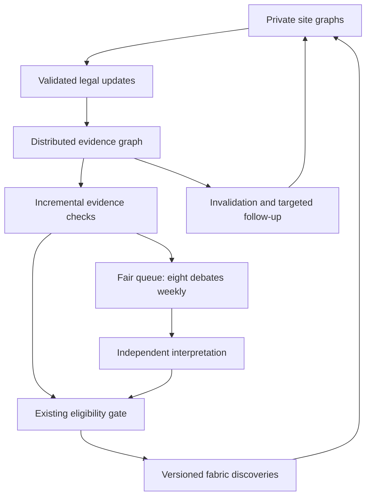

# Architecture proposal: evidence-driven discovery toward the frozen eighty-percent gate

Date: 2026-10-16. Source revision: `ee5dc8ce5142328c2456d43d3e08a8824e5cba75`.
Status: design proposal, informed by development evidence; not implemented, independently reviewed, or measured.
No benchmark setting, frozen source, privacy invariant, cap, model request, or held-out seed changes in this commit.

## 1. The deeper task

A professional systems and evaluation team would first determine whether legal evidence can support the target,
then locate the losses between that evidence and an active, verified discovery. It would reproduce decisions from
event traces, distinguish selection from reasoning, and measure each architectural change against a cost-matched
control. It would not promise a recall figure from a diagram or use a stronger judge to compensate for an invisible
candidate. The deliverable is an executable design with falsifiable gates, not a claim that eighty percent is attained.

The rawest useful material is the per-site record stream, its receipt times and revisions, local source lineage,
the actual Boundary transcripts, candidate queue histories, verifier inputs and outputs, and the resulting fabric
notes. Raw records remain at their sites. Benchmark truth is available only to a separate evaluator after decisions
are sealed. The previous report and its compressed checkpoints are evidence indexes, not replacements for those
streams. The calibrated emulator is a controlled synthetic fixture, not the real site reader.

Methods: event sourcing; typed temporal evidence graphs; incremental joins and truth maintenance; fair queueing;
adversarial retrieval tests; process-enforced role isolation; component-by-component ablations; and the frozen
world-level evaluation. Tools: the existing Python, SQLite, NeuralGraph, Tesseract, keyed JetStream fabric, local
model interface, test harness and immutable Git revisions. A new distributed database or a larger cloud model is
not a prerequisite for this proposal.

Correctness comes from reproducible traces, independent reviewers, machine-checked provenance and eligibility,
privacy attacks that actually fail at the operating-system or Boundary level, and one frozen evaluation on unseen
worlds. Founder or model approval is not a substitute for those observations.

## 2. What eighty percent means here

The primary target remains `docs/collective/EMERGENCE-80/SPEC.md`: the real process-mode end-to-end run at the
target-two-hundred size. Across twenty final held-out worlds, mean `recall_all` and its two-sided ninety-five-percent
Student-t lower endpoint must both be at least 0.80. Every world's privacy checks must pass. Failures count as zero.
The matched baseline must be run on the same worlds. Decoy acceptance must not increase under the approved matched
reading, with both facet-zero and every-facet-in-window counts reported. No scorer, labels or generator are changed.

The real path includes NeuralGraph ingestion, Tesseract routing, the site verifiers, NATS JetStream and the fabric.
The roll-up emulator's ten-thousand-user diagnostics cannot satisfy that gate. They remain a separate scaling track.
The record-level site-verifier accuracy loop also remains separate; its existing target is 0.860 balanced accuracy.

There is no guarantee that the stated invariants admit eighty-percent recall. Feasibility is an architectural gate,
not a footnote. More compute cannot recover a distinction absent from every permitted disclosure.

## 3. Evidence that determines this design

The following counts were recomputed from the committed weekly checkpoint archives, without generating a new world
or changing a decision. Reproduce them by counting story keys in `week-01.json` through `week-26.json` in each archive.

| Diagnostic | Target 10,000 | Target 200 | Source |
|---|---:|---:|---|
| Total story debate visits | 208 | 208 | `runs/recovery-fixture-*/checkpoints.tar.xz` |
| Distinct story keys visited | 39 | 64 | same, union of `stories[].key` |
| Visits after a key's first visit | 169 | 144 | total visits minus distinct keys |
| Largest visits to one key | 25 | 13 | key multiplicity across weeks |
| Peak qualified list | 584 | 132 | largest `qualified` list |
| Found patterns | 0 / 40 | 10 / 40 | corresponding `report.json` |
| True keys debated within their window | 1 / 40 | 15 / 40 | same, conditional on fixture ruling history |

At ten thousand, 37 patterns were outside the cap throughout their scoring windows. Repeat visits account for
169/208 = 81.25 percent of slots, but this does not establish that all repeats were unnecessary. A version-aware
ablation must determine which had material new evidence and whether reallocating them helps.

Code inspection at the source revision supplies additional mechanisms:

- `rollup/protocol.py:candidates` selects one winning chain for each entity. Another coherent chain for the same
  entity can therefore disappear before debate. Its rank then uses handles from all positive kinds on the entity,
  including kinds outside the selected chain. More traffic can outrank stronger causal evidence.
- A hypothesis on the watch list can return without a material evidence change. New handles also trigger returns
  even when they add no new causal relation, time ordering, contradiction or independence threshold.
- `rollup/backends.py:Fixture.complete` treats any negated evidence on the entity as a reason not to support its
  story. It also checks the earliest time for each kind, rather than the existence of a consistent ordered set.
  These are fixture behaviors, not measured limitations of an intelligent model.
- The first gossip diagnostic eventually delivered every emitted summary. Its required crash-before-full-spread
  case was not exercised. Transport success does not establish that the evidence representation or decisions work.

The root-cause report also identifies suppressed rare evidence, warm-up losses, flat chain predicates, echo inflation,
and unrevisited conclusions. Its scratch-derived bounds have different assumptions; they are not a single proof
that this architecture can or cannot pass the frozen gate.

## 4. Architecture and responsibility boundaries

The core change is a persistent evidence graph whose conclusions are updated when relevant facts change. Debate is
an exception path for unresolved interpretations, rather than the only way a signal can advance.

### 4.1 Local memory: records become typed, revisable evidence

Each site owns its raw records, embeddings, evidence graph and private auditor mapping. A local claim has a
canonical entity, fine predicate, polarity, event-time interval, receipt time, source-family identifier,
extraction confidence, extraction/model version and a pointer to its private supporting records. None of these
private fields is automatically an egress field.

Local edges express `precedes`, `supports`, `contradicts`, `supersedes`, `same_source_family` and `same_entity`.
Entity identity is exact or explicitly uncertain; lexical similarity alone cannot join two entities. Duplicate
reports share a source-family component; different hashes or different sites alone do not prove independence.
Uncertain duplicate matches remain uncertain and are tested for false merges as well as missed echoes.

Store both event time and receipt time. A late record may revise a historical hypothesis only at its actual receipt
time. Never use a future event or a future retraction in an earlier decision. Independent positive paths and later
retractions remain distinct objects, so one negative observation does not erase an unrelated valid path.

The benchmark schema comes from the unchanged approved pack. The deployed interface should accept versioned domain
schemas, but this proposal does not claim performance on an unseen field from a single synthetic vocabulary.

### 4.2 Disclosure: preserve two explicitly different privacy regimes

**Strict acceptance mode** uses the existing Boundary contracts, k at least three, the current two-site corroboration
rule, query budgets, suppression, and the prohibition on central raw-text access. Rich local graphs can improve site
retrieval and verification without automatically enriching external messages.

**Experimental summary mode** is the already separately authorized synthetic roll-up arm. Its abstract event kinds,
weekly counts and company-linkable handles are a different disclosure surface. Those outputs cannot be inserted
into strict mode and then described as satisfying its unchanged privacy gate.

The current strict wire format flattens fine events into chain-level information. If cross-site causal order or
cross-site source-family deduplication is not derivable from its allowed artifacts, that distinction is unavailable
to the receiving layer. Do not pretend an LLM can infer it reliably from missing information.

A possible extension is an auditor-replayable, thresholded temporal/independence certificate, with no narrative or
record identifiers. Its fields, threshold unit, collusion assumptions and repeated-query exposure must be specified
and reviewed before use. A signed certificate attests origin, not the truth of the represented event. Per-kind
time buckets, opaque handles and Boolean answers can themselves disclose membership through composition.

Such an extension requires its own dated contract amendment and privacy review. It is not silently included in
this proposal, and no below-k sharing, secure-sum protocol, threshold reduction or single-site support is authorized
by this document. If it is necessary for recall, that dependency becomes an explicit result of the feasibility gate.

### 4.3 Candidate formation: retain all coherent hypotheses without debating all of them

Maintain keys for `(entity, chain, episode)` rather than selecting one chain per entity. An episode is an internally
versioned temporal cluster formed using only legally visible event information. The fabric's scored key remains the
frozen `(entity, chain)` key, and all episode decisions and revisions are retained in the audit trail. Episodes must
not be created or timed from evaluation labels.

Within a causal chain, find whether an ordered, compatible witness set exists. Do not substitute a vector of the
earliest times for that existence test. Where the domain requires a contiguous path of three kinds, a two-kind lead
stays in memory awaiting its missing kind; it need not consume a full multi-role debate every week.

Partition each hypothesis into:

1. **Incomplete:** remember its missing relation or witness; register a bounded local watch.
2. **Structurally contradicted or invalid:** retain the reason and wait for a material revision.
3. **Eligible under existing verified evidence:** pass through the existing eligibility gate; never synthesize a
   site confirmation from an entity/chain match alone.
4. **Structurally plausible but semantically unresolved:** enter the expensive interpretation queue.

This removes repeated full-context reasoning from ordinary state maintenance. It does not allow code to bypass
site verification, source independence, freshness, corroboration or lineage requirements. If permitted artifacts
cannot establish a distinction, classify it unresolved rather than inventing a witness.

### 4.4 Scheduling: preserve an eight-debate control budget

The proposed first comparison retains at most eight full debates per week. It changes admission and revisit policy,
not the cap. A full debate includes all required advocate, skeptic, rebuttal and judge work; batching must not hide
extra story decisions outside that accounting. Deterministic checks and local model extraction have separate,
explicit compute ledgers, so shifting work earlier is not called free compute.

A candidate's material revision fingerprint covers its chain-relevant witness structure, legal independence bucket,
ordered time constraints, relevant polarity/retraction state, and the eligibility outcome. An extra routine handle
in the same state does not, by itself, justify another full debate. Watch membership alone does not do so either.
Keep previous arguments with their evidence versions, and invalidate only those affected by a revision.

Proposed initial allocation, to be frozen before its first new experiment:

- Four slots for never-reviewed, debate-ready keys, oldest-ready first, with deterministic hashed ties.
- At most two slots for material revisions to reviewed keys. Invalidations can immediately revoke an unsupported
  note without spending a debate slot; interpreting a replacement still consumes the budget.
- Two slots for the longest-waiting ready keys closest to expiry of their public evidence, across queues.
  Unused slots return to the never-reviewed queue before repeats. Never use a hidden scoring-window endpoint.

Within a week's allocation, use round-robin across entity/chain groups to reduce dominance by one busy entity.
Persist ready time, last reviewed version, selection reason and skipped reason for every key. A repeated inference
on identical input is refused by the ledger. A supported key can return after a material contradiction or revision;
it is not permanently excluded.

This policy is a proposal, not a demonstrated solution. Eight slots cannot provide a finite waiting guarantee under
arbitrarily high arrivals. Before the model pilot, replay the legal arrival trace to compare demand and deadlines
with service capacity. If the budget cannot meet them, report overload. Any capacity change is a separate arm with
a separately frozen cost budget; neither the existing cap nor its past result is rewritten.

**Distributed ownership and budget.** Each entity/chain has a deterministic owner for an agreed membership epoch,
with replicated legal evidence and audit state at peers. A rotating coordinator proposes the week's allocation;
the allocation and eight non-reusable dispatch tokens require the existing fabric's quorum-backed coordination
facility, or a separately reviewed equivalent. This ledger contains task identifiers and budget state, not raw
records or a central copy of private memories. A disconnected component may spend only its already committed
tokens; it cannot mint more. If no such coordination primitive is available, stop new global dispatch during a
partition rather than claiming both unrestricted availability and an exact global cap.

Bind each dispatch to a hypothesis/evidence version and all its role calls. Consuming a token is durable before
starting inference. An ambiguous or lost inference attempt is charged and retained, not reissued as an uncounted
new task. Retries have separate attempt identifiers and appear in the token/compute ledger. Model APIs are not
assumed to support exactly-once execution. Recovery must distinguish an absent result from an inference known never
to have started. Deterministic ownership, bounded dispatch and publication idempotency are separate invariants.

### 4.5 Retrieval and questioning: request the missing distinction

Use NeuralGraph relations and Tesseract to retrieve a chain's relevant local witnesses, their likely source echoes,
and its strongest counterevidence. Retrieve positive and negative evidence in separate bounded lists, then resolve
their relation. A reranking improvement must change recall of the required local evidence, not merely a ranking score.

Follow-up asks one unresolved distinction: a missing temporal link, independent source, scope of a retraction, or
ambiguous entity. Its time/window and predicate derive from the current legal state. Existing per-site and per-entity
question budgets remain enforced by the site, not merely by a coordinator. Equivalent questions are deduplicated;
budget refusals are not retried under new identifiers. Do not evade the cap by moving the synthetic site clock.

No warm-up-dependent anomaly snapshot is required merely to retain a legal rule-derived lead. This does not permit
pre-threshold disclosures or undeclared time windows. It removes an unnecessary snapshot requirement from the new
candidate-source arm, after its dated preregistration and the required reviews.

### 4.6 Interpretation and decisions: model advice, machine-checked support

The advocate receives only its legally available evidence; the skeptic sees the allowed submitted case; the judge
sees the case and countercase. Each role returns strict structured references to evidence it was actually given.
Unsupported references, unknown entities, future timestamps or invented relationships are refused.

Disagreement produces a hypothesis or a bounded follow-up, not a majority vote that overrides missing evidence.
The final support decision remains a checked consequence of admissible site verdicts, independent support, valid
time, corroboration and lineage. A model can interpret evidence or identify an alternative explanation; it cannot
waive the eligibility gate. A site's replayable auditor resolves its own opaque references without exporting records.

Use source-scoped contradiction handling: identify which assertion, event and time interval the negative evidence
addresses. A cancellation of event A does not veto independent event B. Conversely, a retraction that invalidates
the selected witness must invalidate every dependent claim, including previously supported fabric notes.

### 4.7 Durable transport and truth maintenance

Reuse the existing real fabric. Persist an origin-local event log, a transactional outbox and an idempotent consumer
inbox. Apply an event and record its identity in the same SQLite transaction, commit, then acknowledge it. Broker
deduplication and double acknowledgments are useful, but application correctness must survive the deduplication
window and a crash between database commit and acknowledgment.

Each hypothesis and discovery records its supporting evidence versions. A reverse dependency index maps an evidence
revision to every affected hypothesis and conclusion. Corrections trigger incremental re-evaluation and a versioned
replacement, expiry or retraction. Peers propagate evidence revisions and conclusion versions, not just additive
summaries. An older update cannot resurrect a conclusion already revoked by a newer causally ordered revision.

Use explicit origin epochs and sequence numbers with deterministic conflict refusal. For the missing transport case,
register a causal test barrier that withholds a chosen summary's acknowledgments, proves incomplete replication,
then crashes that origin. Assert that the intended condition occurred before interpreting recovery. This is a new
test protocol, not a retroactive change to the recorded seeded diagnostic.

## 5. Separate capabilities and filesystem boundaries

Role prompts are inputs to an isolated worker, not instructions granting repository access. The evaluator's world
generator, truth, scorer, expected verdicts and answer artifacts are absent from the worker's filesystem and process
environment. Run workers with an allowlisted read-only input, a designated output channel, no network, no inherited
credentials or unrelated file descriptors, restricted process access and operating-system-enforced limits.

Use filesystem restrictions together with process/network isolation. Detect the actual kernel features; fail closed
if the required restrictions cannot be enforced. Logging other tool use is an additional audit, not the isolation
boundary. The local inference server is trusted infrastructure with an explicit bounded channel, not an unrestricted
tool exposed to the role. It must not have the evaluator's answer mount either.

Test actual access attempts through absolute and relative paths, symlinks, environment variables, process files and
network endpoints. Plant harmless canaries outside the permitted input. A deliberately adversarial worker must fail
to read them. A role's self-reported audit or an unverified JSON transcript cannot pass this test.

The original session-subagent pilot remains blocked unless that environment can supply its required verifiable audit
and capacity evidence. This proposal does not re-label an unisolated call as valid. For implementation, prefer the
already permitted local-model worker path when it can enforce these boundaries.

## 6. Feasibility and evaluation gates

### Gate F: observability and legal evidence

Before changing models, compute an optimistic reachable-key/window bound using the actual admissible transcripts and
the frozen scoring rule. Evaluate existing and proposed artifact contracts separately. A pattern-facet-only census
is not automatically an upper bound for a scorer that credits a key/window supported by other lawful evidence.
Document the assumptions and validate any claimed upper bound against observed runs.

Pair this with an evidence-faithful diagnostic that requires the discovery's claimed witnesses to support its story.
Never replace the primary metric with that diagnostic or exploit a discrepancy between them. In particular, a
benchmark pattern may remain labelled true despite a contradiction; report the primary score and the semantic
validity of the supported note separately.

If a validated upper bound is below the required target under an invariant, document the obstruction. Do not claim
an eighty-percent design under that invariant or start an expensive attempt expected to be structurally impossible.
If a richer disclosure protocol is needed, present that precise contract change and exposure before implementation.

### Gate C: coverage before expensive reasoning

Using sealed decisions and an evaluator that never informs policy during a run, report per world:

- patterns with enough admissible evidence, with the stated bound assumptions;
- those represented by a retained hypothesis;
- those ready, scheduled, and visited within their scoring window;
- those with the required local evidence retrieved;
- those confirmed and active in the fabric with verified lineage.

Give exclusive first-loss categories and per-class decoy traces, not just an aggregate recall. Separate real
evidence errors from the fixture's deliberately simulated ones. Record queue ages, unique/repeat visits, incomplete
lead counts, rank reasons, material revisions, prompt tokens, local inference tokens, CPU time and peak memory.

These stage counts can describe an exact conditional survival chain when the sets are nested; they are not
independent probabilities to multiply speculatively. An eighty-percent point estimate at one seed is not the
world-level confidence gate. Aim for margin in development; do not weaken the held-out bar to match observed variance.

### Gate A: ablations and controls

First run the unchanged control, then each registered lever alone, then the combined candidate on development seeds:

| Lever | Question it must answer | Control that prevents a misleading win |
|---|---|---|
| Multiple chains/episodes | Are coherent stories lost by single-chain projection? | Same model, evidence, budgets, thresholds and score. |
| Material-version scheduling | Do repeated visits suppress distinct ready keys? | Cap eight; account for all extraction and checking work. |
| Ordered witnesses | Does an existential path check recover valid order without accepting scrambled events? | Same disclosure contract; temporal-scramble class reported. |
| Scoped contradiction and revision | Do unrelated negatives cause rejection, and do relevant retractions revoke support? | True-key false alarms and stale-chain acceptance both reported. |
| Source-family independence | Are echoes mistaken for independent evidence, or distinct events falsely merged? | Duplicate-inflation decoys plus independent-source recall tests. |
| Graph-aware targeted retrieval | Does the reader actually see the missing witness and counterevidence? | Same read/query budgets; a score-only rerank cannot claim success. |
| Selective interpretation | Does the model add evidence-grounded decisions? | No-debate and same-model judge-only arms, with comparable compute recorded. |

No held-out world is used to set a queue policy, extraction threshold, episode rule, model or prompt. No arm is
selected because it happens to use a favorable sampled seed. The calibrated fixture is a smoke/ablation backend;
the real path and real local reader must run before any primary performance claim.

### Gate H: freeze and one final evaluation

Follow SPEC's sequence: architecture, three independent adversarial reviews, dated amendment, build, tests,
development ablations, candidate freeze, preliminary validation, final freeze and one held-out evaluation.
The three reviewers cover distributed state/liveness, retrieval/causal validity, and privacy/benchmark integrity.
Reviews are pending, not implied by this document.

Freeze every policy and source digest, including the generator, labels, scorer, pack, gate, budgets, model versions,
decoding settings, episode rules, egress contract, extraction prompts and hardware envelope. Derive seeds only from
the appropriate pushed freeze revision. Preserve failed worlds and report both accepted and rejected decoys under
matching readings. Do not pick the best of several final runs.

## 7. Implementation sequence and interfaces

Use a new package such as `rollup_v2/` outside the frozen source paths until the proposal and adapters have been
reviewed. Do not copy this experiment into a deployment image implicitly. Proposed interfaces are responsibilities,
not a requirement to introduce a service for each module.

| Component | Input | Output / enforceable invariant |
|---|---|---|
| `local_evidence` | Site-owned record/revision stream | Typed local claims and auditor mapping; no raw export. |
| `disclosure` | Local graph and an approved contract | Existing legal artifacts, or separately approved certificates. |
| `evidence_view` | Legal events and corrections | Versioned multi-chain hypotheses and reverse dependencies. |
| `eligibility` | Current verified evidence | Missing conditions, invalidation, or lawful gate input. |
| `scheduler` | Legal ready states and visit ledger | At most eight debate visits; public-state reasons, no answer access. |
| `retrieval` | One unresolved distinction and site budget | Bounded local witnesses/counterevidence and site verdicts. |
| `adjudication` | Allowed case packets | Structured, evidence-referencing interpretation; no eligibility override. |
| `publication` | Checked decision and evidence versions | Idempotent fabric note/revision/retraction with lineage. |
| `evaluation` | Sealed artifacts and truth | Frozen primary score, matched decoy counts and stage diagnostics. |

Build order: feasibility/transcript tooling; local evidence and revisions; privacy boundary; incremental hypothesis
view; fixed-budget scheduler; targeted retrieval; isolated interpretation; real-fabric adapter; then registered
ablations. Each change has an independent commit and a regression that fails without its intended property.
Do not start by increasing the model size or the global debate cap.

## 8. Rewritten execution prompt

Continue NeuralGraph on the deployment branch. Read this proposal, the current handoff status, SPEC and the original
roll-up plan/amendment before editing. This is an evidence-first attempt at the frozen EMERGENCE eighty-percent
`recall_all` gate, not the separate record-level accuracy loop. Do not promise that the goal is attainable.

Start from private site record streams, receipt/revision times, Boundary transcripts, queue decisions, retrieval
inputs, site verdicts and fabric notes. Use the committed recovery checkpoints to reproduce the 208 visits, 39
distinct keys and 169 repeat visits at the larger size. Preserve all previous results. Never give the candidate
policy, model worker or site reader the evaluator's labels, event truth, pattern identifiers or answer artifacts.

First implement only read-only feasibility and trace tooling in a new package. Determine which missing distinctions
are legally observable under k at least three, the current two-site rule, unchanged suppression and budgets. Any
upper-bound claim must respect the frozen key/window score, not assume a stricter witness definition without saying
so. If the target is structurally impossible under those assumptions, produce the evidence and stop the expensive
run. Specify any needed privacy-contract change separately; do not implement an invariant change implicitly.

Prepare a dated preregistration for the proposed multi-chain/episode graph, material-revision scheduling, existential
temporal witnesses, source-scoped contradictions, dependency-based retraction and targeted local retrieval. Keep an
eight-debate control arm. Account separately for local extraction, deterministic checks, retrieval and every model
role. Retain incomplete leads cheaply; do not repeatedly debate an unchanged hypothesis. Freeze proposed policy
parameters before their first run. Alter neither the current plan nor a past outcome retroactively.

Obtain the three independent adversarial reviews required by SPEC. Amend the design in a separate commit before
implementation or pilot. Build outside frozen paths. Keep raw notes and local record mappings at their sites. Use
the existing real NeuralGraph, Tesseract, site-verifier, keyed NATS and fabric interfaces for any run that claims the
primary gate. A toy graph, emulator, fixture, oracle merge or session stand-in cannot replace those legs.

Enforce model-worker isolation with operating-system boundaries, not instructions to avoid answer files. Mount only
its allowed input, remove the truth/evaluator from its environment, close unintended descriptors, deny unrelated
network/process access, and test an adversarial worker against canaries. Fail closed when required restrictions or
auditable capacity limits are unavailable. Existing hosted approval remains synthetic-only and never covers real
records or the accuracy loop. Do not conceal a blocked pilot by substituting fixture decisions.

Test multi-chain entities, unrelated negations, relevant retractions, multiple valid temporal witness choices,
cross-site echoes, false duplicate merges, late arrivals, cold leads, saturated queues, budget exhaustion and answer
access attacks. For transport, enforce and record a barrier proving incomplete replication before the injected
origin crash. Test duplicate, delayed, reordered and replayed messages, loss, partitions and stale-update resurrection.
Machine-check origin versions, database commit/ack recovery and all final active lineage.

Run the unchanged control and each lever alone before combining them, on registered development seeds only. Report
real versus synthetic evidence separately, and report every run including failures. Use matched baseline worlds and
matching facet-zero/every-facet decoy readings. Report stage loss, unique/repeat visits, waiting times, evidence
retrieval, contradiction false alarms, live fabric notes and all compute. Never tune on preliminary or held-out
outcomes outside SPEC's explicit rules.

Only after a reviewed candidate and green required suites: push a freeze, derive its preliminary seeds, run the
preliminary validation, then follow the final-freeze procedure. The first final run is the result. Passing means
mean and Student-t lower endpoint at least 0.80 across twenty held-out real end-to-end worlds, every privacy check
passing, and no increased matched decoy acceptance. If it fails, preserve the failure, quantify the missing stage
and identify the next falsifiable architectural lever. Do not change the target, labels, generator or score.

## 9. Sources and claim limits

Repository sources: `SPEC.md`; `EMERGENCE_ROOT_CAUSE_REPORT.md`; `PLAN-ROLLUP-001.md`; the recovered results and
checkpoint archives; `rollup/protocol.py`; `rollup/backends.py`; and the existing `edge/egress.py` and
`pushdown/gate.py`. File names in this paragraph are relative to their existing repository locations.

External primary references consulted for infrastructure semantics:

- NATS maintainers, [JetStream model deep dive](https://github.com/nats-io/nats.docs/blob/master/using-nats/jetstream/model_deep_dive.md):
  message deduplication and double acknowledgments. These broker mechanisms do not atomically commit an external
  application database; the inbox/outbox invariant above is an architectural requirement.
- Linux kernel documentation, [Landlock](https://docs.kernel.org/userspace-api/landlock.html) and
  [no new privileges](https://docs.kernel.org/userspace-api/no_new_privs.html): enforceable restrictions and feature
  availability. Filesystem restrictions alone are not a complete process/network sandbox.

The architecture, queue allocation and implementation order are engineering proposals inferred from the observed
failure modes. None is a measured recall improvement. No model, independent review, new benchmark world or held-out
evaluation ran to produce this proposal.
