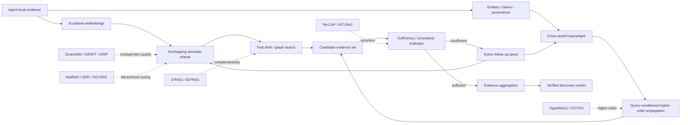
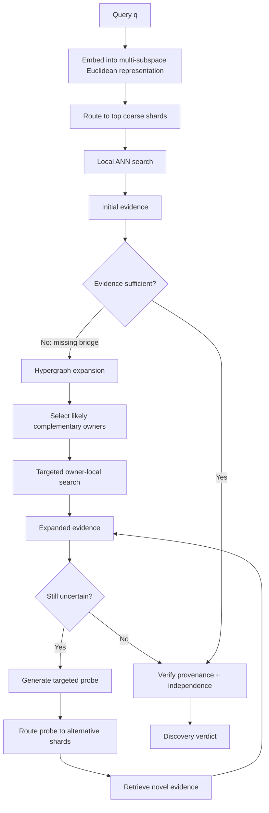
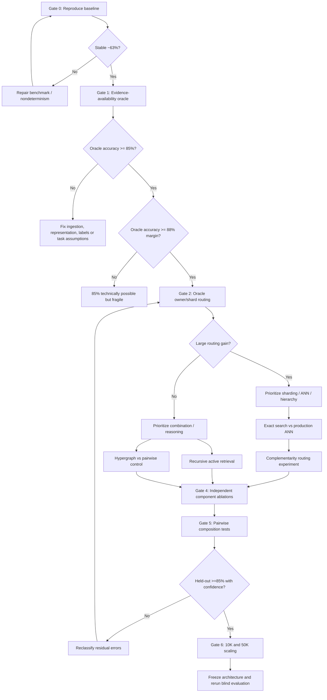

# Frontier Research Report: Paths from ~63% Toward ≥85% Distributed Discovery Accuracy

## Executive summary

I searched recent arXiv work with **first submissions between August 24 and October 24, 2026**, which is stricter than your requirement of “first published or substantively updated” in that interval. The most relevant concentration of new work is not one single breakthrough paper; it is a convergence of five ideas: **complementarity-aware geometric retrieval, query-conditioned hypergraph propagation, iterative evidence-coverage probing, geometry/partition-aware ANN diagnosis, and hierarchical adaptive routing**. citeturn9view3turn9view4turn9view5turn11view2turn9view1

The strongest individual papers for your use case are:

1. **HyperReCo** — learns query-dependent higher-order interactions between documents and entities, then explicitly decodes hyperpaths connecting complementary evidence. This is the most direct recent match to “truth distributed across independent owners.” citeturn9view5
2. **G³RAG** — constructs a graph from embedding geometry alone and rewards edges that are simultaneously query-direction-consistent and nonredundant; it reports up to 4.26 average F1 improvement among evaluated graph baselines and avoids LLM graph-construction cost. citeturn9view3
3. **SG²RAG** — explicitly learns **semantic gain**, rather than similarity, between pieces of evidence. Under fixed candidate support and propagation, semantic-gain weighting improved average F1 by 4.08 points and Recall@10 by 4.31 points over similarity weighting. citeturn9view4
4. **Re:CAP** — repeatedly asks what evidence is probably missing and retrieves again. On MuSiQue it improved recall by 12.9 percentage points over flat hybrid top-500 while using less than half the document budget; it also found relevant documents that large BM25/dense/hybrid ensembles missed. citeturn11view2
5. **SmartANN** — provides almost exactly the experimental discipline needed before rebuilding your routing layer: causal diagnosis of ANN stages with **oracle substitutions** to determine where recall is actually being lost. Its authors report recall improvements ranging from 0.24% to 74.20% across evaluated ANN configurations, demonstrating that index-stage losses can vary enormously by corpus and configuration. citeturn9view1turn10view0

My central conclusion is therefore **not** “replace everything with a hypergraph.” It is:

> **Build an overlapping Euclidean shard fabric for inexpensive locality; add a sparse cross-shard hypergraph representing higher-order complementary evidence; and run an uncertainty/sufficiency-driven recursive retrieval controller over both.**

The shard layer answers **where to search**. The hypergraph answers **what evidence belongs together even when it is not nearest-neighbor similar**. Recursive acquisition answers **whether the system has enough evidence yet**.

The literature does **not** support a credible claim that any one of these changes will take a system from 63% directly to 85%. The 22-point gap is too large to extrapolate from unrelated benchmarks. The first scientific question is instead whether **85% is inside the system's information-theoretic ceiling**. The correct first experiment is an **evidence-availability upper bound**, followed immediately by oracle owner/shard routing. If fully oracle-routed legitimate evidence still produces <85%, retrieval architecture cannot solve the target by itself.

My strongest research prior is that a large improvement is plausible only if the present 63% contains a substantial population of errors in which the necessary evidence **exists somewhere in the distributed system but fails to meet in the same inference context**. HyperReCo, G³RAG, SG²RAG, NexusRAG, STITCH-RAG, and Re:CAP all attack variants of precisely that failure mode. citeturn9view5turn9view3turn9view4turn7view12turn11view3turn11view2

## Ranked recent literature

The ranking below prioritizes **direct relevance to distributed evidence discovery**, then strength of the mechanism and evaluation, scalability implications, and implementation accessibility. A paper can therefore rank below another even if its benchmark improvements are larger.

“Code not linked” means I did not find an author code link on the arXiv record during this search; it does **not** prove that no implementation exists elsewhere. The five rows marked with code links have artifacts explicitly linked from their papers/arXiv records. citeturn7view2turn7view4turn7view11turn7view12turn9view3

| Rank | Paper and arXiv | Date | Main contribution | Code | Why it matters for EMERGENCE |
|---|---|---|---|---|---|
| **1** | [HyperReCo: Retrieving and Connecting Evidence with Hypergraph Neural Networks for LLM Multi-hop Reasoning](https://arxiv.org/abs/2609.32327), **2609.32327** | Sep 26 | Documents become hyperedges over entities; query-dependent HyperGNN message passing retrieves complementary evidence; gradient attribution decodes explicit hyperpaths. citeturn9view5 | Not linked on arXiv | Closest match to cross-owner facts that become useful only jointly. It attacks both retrieval and **connection reconstruction**, not merely ranking. |
| **2** | [Beyond Similarity through Zero-Token Geometric Graphs for Multi-Hop RAG](https://arxiv.org/abs/2609.19622), **2609.19622** | Sep 17 | G³RAG weights graph edges with geometric gain, \(\cos\theta\sin\theta\), combining directional consistency with novelty/orthogonality; adds hub suppression and controlled diffusion. Reports up to +4.26 average F1 and +5.76 on MuSiQue versus evaluated graph baselines. citeturn9view3 | [Artifact](https://anonymous.4open.science/r/G3RAG-99D9/) citeturn10view5 | Very attractive for a Euclidean-first architecture: discover complementary evidence without expensive entity extraction. |
| **3** | [Retrieving Complementary Evidence for Multi-Hop RAG with Semantic Gain Graphs](https://arxiv.org/abs/2610.15285), **2610.15285** | Oct 11 | SG²RAG explicitly estimates nonredundant information gained by adding one chunk given another, then propagates through a semantic-gain graph using controlled PPR. citeturn9view4 | Not linked on arXiv | Provides a principled alternative to “nearest = useful.” Particularly relevant when owner B contains weakly query-similar but decisive evidence. |
| **4** | [Re:CAP — Auditing Retrieval Coverage in Production RAG Pipelines](https://arxiv.org/abs/2609.24122), **2609.24122** | Sep 21; v2 Sep 22 | Iteratively identifies missing topics, generates probing questions, retrieves again, and keeps newly informative evidence. It beats flat hybrid top-500 by +12.9 pp recall on MuSiQue at less than half the document budget. citeturn11view2 | Not linked on arXiv | Direct blueprint for recursive evidence acquisition and, equally importantly, an audit instrument for measuring unreachable evidence. |
| **5** | [SmartANN: Object Causal Modeling Boosts Approximate Nearest Neighbor Diagnosis and Auto-Design](https://arxiv.org/abs/2609.08240), **2609.08240** | Sep 8 | Decomposes ANN into eight replaceable causal stages; swaps suspected stages with oracles/better implementations to localize losses; instantiated for HNSW and IVF-PQ. citeturn9view1 | [GitHub](https://github.com/zhouyutong20/SmartANN) citeturn10view0 | This is the right methodology for determining whether your 63% is actually an index/routing problem before inventing a larger model. |
| **6** | [STITCH-RAG: Spatio-Temporal Influence Tracing over Topic Hypergraphs](https://arxiv.org/abs/2609.34127), **2609.34127** | Sep 28 | Builds topic hyperedges while retaining per-chunk entity states; propagates through topic space and canonical-entity links and uses continuous priors for localized PPR. citeturn5view13turn11view3 | Not linked on arXiv | Particularly relevant when identity-equivalent evidence is distributed across owners but occurs in distinct contexts. |
| **7** | [Corpus-Guided Dual-Path Propagation for Graph RAG / NexusRAG](https://arxiv.org/abs/2609.37661), **2609.37661** | Sep 29 | Combines semantic sentence propagation and structural entity propagation using a corpus-level entity neighborhood; reports +4.2–8.1 evidence-recall points on a GraphRAG-Bench subset. citeturn7view12 | [GitHub](https://github.com/Jacob-biu/NexusRAG) citeturn10view4 | Strong evidence that **bridging evidence should not be required to have high direct query similarity**. |
| **8** | [A Matryoshka Hierarchical RAG for Efficient Multi-Hop Question Answering](https://arxiv.org/abs/2610.01767), **2610.01767** | Oct 1 | Builds a DAG of clusters at increasingly coarse semantic granularity and aligns levels with Matryoshka embedding dimensions; iterative top-down routing adapts hop budget. citeturn5view8 | Not linked on arXiv | Natural template for 10K–50K-agent hierarchical routing where coarse decisions should use less compute than local discrimination. |
| **9** | [RIT-RAG: Navigating Document Corpora with Retrieval-Induced Trees](https://arxiv.org/abs/2610.11370), **2610.11370** | Oct 8; v2 Oct 16 | Broad retrieval induces manageable structural subtrees across documents; an agent navigates them, reads selectively, and reformulates queries. Reports +6.6–11.4 accuracy points over the strongest baseline on EntQABench. citeturn11view1 | Not linked on arXiv | Shows a scalable pattern in which retrieval proposes a search region and an agent decides where to recurse rather than committing once. |
| **10** | [ISO-RAG: Isoperimetric Noise Control for Retrieval-Augmented Generation](https://arxiv.org/abs/2609.00513), **2609.00513** | Sep 1 | Projects a KG into a Poincaré ball, precomputes isoperimetric profiles, prunes noisy edges, and runs localized PPR; reports +10.0 absolute retrieval recall and +4.3 EM averaged over evaluated multi-hop QA settings. citeturn7view11 | [GitHub](https://github.com/ZaiizaiZHANG/ISO-RAG) citeturn10view3 | The exact geometry is hyperbolic rather than Euclidean, but the transferable idea is crucial: **purify topology before diffusion**. |
| **11** | [Building Navigable Graphs Without Search in Three Composable Stages](https://arxiv.org/abs/2610.09041), **2610.09041** | Oct 6 | Constructs ANN graphs through partition-local candidate pools, bounded pruning, reverse edges and a reachability spine; supports arbitrary partitioners and evaluates up to \(10^8\) points. citeturn5view4turn7view4 | [GRAFT](https://github.com/zevahcle/graft-ann) + [experiments](https://github.com/zevahcle/fgraft-experiments) citeturn10view1turn10view2 | Useful engineering substrate for shard-local navigability without requiring expensive global neighbor search. |
| **12** | [Getting a GRIP on Graph-Based Search for Learned Sparse Retrieval](https://arxiv.org/abs/2610.30425), **2610.30425** | Oct 21 | Combines term-based entry-point seeding, sparse sketch routing and partition-based graph construction; reports 2.5× lower latency than Seismic at 95% Recall@10 on 138M MS MARCO v2 passages. citeturn5view5 | Not linked on arXiv | Suggests hybrid sparse/geometric shard entry points can be much better than one universal routing signal. |
| **13** | [Closed Forms and Synthetic Twins: Predicting ANN Recall from Embedding Statistics](https://arxiv.org/abs/2609.00364), **2609.00364** | Aug 31 | Predicts PQ/FDE, partition-index and graph-index recall from embedding statistics or synthetic “twin” corpora; reports prediction error within 0.03 on an unseen million-document corpus. citeturn8view5 | Not linked on arXiv | Valuable because your retriever may be mathematically incompatible with its serving index even when exact-vector evaluation looks strong. |
| **14** | [Agent-Enhanced Heterogeneous Graph RAG for Academic Question Answering](https://arxiv.org/abs/2609.00761), **2609.00761** | Sep 1 | Explicitly separates query-aware routing, sufficiency-aware adaptive subgraph expansion, and graph-grounded verification. citeturn11view4 | Not linked on arXiv | Nearly the control-loop structure a distributed discovery system needs: route → assess sufficiency → expand → verify. |
| **15** | [Asymmetric Dynamic Routing: Balancing Reasoning Depth and Computational Efficiency in Hypergraph RAG](https://arxiv.org/abs/2609.29282), **2609.29282** | Sep 24 | Routes queries among fact anchoring, bottom-up diffusion, and top-down grounding depending on intent; reports token reduction up to 48.7% and latency reduction 45.3%. citeturn11view0 | Not linked on arXiv | Useful for preventing the two opposite distributed failures: needless fanout and premature local stopping. |
| **16** | [LiteRAG: Cost-Efficient Graph-Based Retrieval-Augmented Generation](https://arxiv.org/abs/2609.10239), **2609.10239** | Sep 9 | Replaces expensive LLM-controlled retrieval with query-conditioned algorithmic exploration and compact reasoning-chain construction; reports >100× lower latency and >99% lower query cost than GraphRAG Global/DRIFT on DistComp. citeturn5view9 | Not linked on arXiv | Important if recursive/cross-shard discovery succeeds but becomes computationally prohibitive. |
| **17** | [Graph Topology Meets Energy-Driven Pathfinding / ThreadRAG](https://arxiv.org/abs/2610.29933), **2610.29933** | Oct 21 | Keeps semantically coherent text units, connects them via narrative/semantic/lexical edges, and finds evidence paths via energy diffusion. Reports +14.4% EM over text-centric methods on HotpotQA and +5.8% over its best 2Wiki baseline. citeturn8view0 | Not linked on arXiv | Warning against over-symbolizing your NeuralGraphs: graph compression itself may erase evidence needed downstream. |
| **18** | [Embedding Subspace Partitioning for Dynamic Multi-Objective Retrieval](https://arxiv.org/abs/2609.30601), **2609.30601** | Sep 24 | Partitions embeddings into isolated objective-specific subspaces with runtime-adjustable similarity weights; demonstrated both on MS MARCO and LinkedIn's production matching system. citeturn9view2 | Not linked on arXiv | Suggests separating “semantic relevance,” “novel evidence,” “trust,” and “owner-routing” geometry instead of forcing all objectives into one vector. |
| **19** | [ConRAG: Lightweight Inference of Multi-Hop Relations](https://arxiv.org/abs/2609.35193), **2609.35193** | Sep 28 | Builds a lightweight entity-document graph and recovers semantically ranked paths between known endpoint entities; improves bridge-entity/reasoning-chain recovery while reducing indexing-token cost. citeturn8view1 | Not linked on arXiv | Especially interesting for EMERGENCE tasks where two observations are known and the missing goal is discovering the hidden bridge. |
| **20** | [Feedback-Assisted Trust Propagation over Document Relation Graphs](https://arxiv.org/abs/2609.00543), **2609.00543** | Sep 1 | Propagates sparse reliability feedback over document relations and incorporates resulting trust scores into retrieval and answer generation. citeturn8view2 | Not linked on arXiv | Distributed evidence cannot simply be counted: correlated, stale or unreliable owners must not receive multiplicative confidence. |
| **21** | [Interpretable Hypergraph Learning via Neural Additive Models](https://arxiv.org/abs/2610.07458), **2610.07458** | Oct 5 | HGNAN combines additive feature decomposition with hypergraph structural aggregation while retaining node/hyperedge interpretability. citeturn8view3 | Not linked on arXiv | Lower direct retrieval relevance, but valuable for determining **which hyperedge features actually produce a routing decision** rather than deploying an opaque HyperGNN. |
| **22** | [Why Multi-Layer Message Passing Works: Completeness Theory for Graph Neural Network Interatomic Potentials](https://arxiv.org/abs/2609.00528), **2609.00528** | Sep 1 | Proves, in its interatomic-potential setting, that \(L\) sparse message-passing layers can match access to an \(L\)-hop neighborhood under genericity, overlap and connectivity assumptions. citeturn8view4 | Not linked on arXiv | Not a retrieval paper, so transfer must be treated cautiously; nevertheless it provides useful theory for when repeated local propagation can replace one huge interaction radius. |

The most important cross-paper pattern is that **semantic similarity by itself is increasingly treated as insufficient for multi-hop retrieval**. G³RAG introduces geometric novelty, SG²RAG explicitly models nonredundant contribution, NexusRAG recovers weakly query-similar bridges, and HyperReCo learns query-conditioned higher-order interactions. citeturn9view3turn9view4turn7view12turn9view5

That pattern is unusually relevant to distributed discovery. If every agent independently retrieves the items nearest to the original query, thousands of agents can all retrieve **redundant evidence** while nobody searches for the missing complementary fact.

## Mathematical synthesis of the promising mechanisms

Let \(N\) denote total evidence items, \(A\) agents, \(d\) embedding dimension, \(S\) shards, \(K\) retrieved candidates, \(H\) hyperedges, \(I=\mathrm{nnz}(\mathbf H)\) incidence memberships, and \(T\) recursive retrieval rounds. Complexities below are architecture-level estimates rather than claims made verbatim by the papers.

| Method | Core formulation | Assumptions | Approximate cost | Principal failure mode |
|---|---|---|---|---|
| **Metric learning** | Learn \(z=f_\theta(x)\in\mathbb R^d\) with a ranking loss such as \(\max[0,d(q,p)-d(q,n)+m]\). For discovery, redefine \(p\) as *evidence that contributes to solving the query*, not merely semantically similar evidence. | Training supervision distinguishes useful/complementary evidence from topical similarity. | Training roughly linear in sampled pairs/triplets and \(d\); exact retrieval \(O(Nd)\), ANN sublinear empirically. | The embedding collapses different relations into one notion of closeness; hard negatives may actually be useful bridge evidence. ESP's multi-subspace result is evidence that heterogeneous retrieval objectives can interfere when forced into one embedding. citeturn9view2 |
| **Euclidean complementary geometry** | For normalized vectors, use query-aligned and orthogonal components. G³RAG's edge score is \(g_{ij}=\cos\theta_{ij}\sin\theta_{ij}\), favoring evidence neither redundant nor directionally unrelated. citeturn9view3 | Embedding angles encode both semantic direction and novelty. | Graph build depends on candidate-neighborhood size; local diffusion is approximately \(O(|E_\text{local}|)\). | High-dimensional angle concentration; “orthogonal” can mean irrelevant rather than complementary; hub formation. |
| **Semantic-gain graphs** | Conceptually estimate \(G(j\mid i,q)\approx\) information useful for \(q\) supplied by \(j\) that is not already supplied by \(i\), then propagate from query seeds over \(G\). SG²RAG learns this offline and uses controlled PPR online. citeturn9view4 | Pairwise gain predicts set-level complementarity; offline judgments generalize to future queries. | Potentially expensive offline pair scoring; online sparse PPR near-linear in traversed edges per iteration. | Pairwise gain is not generally submodular; three-way evidence interactions may be invisible to pairwise edges. |
| **PQ / IVF / ANN** | Split \(x=[x^{(1)},...,x^{(M)}]\); quantize each block to \(c_{m,k^*}\). IVF first routes to coarse centroids, then PQ approximates candidate distances. | Nearest-neighbor ordering survives coarse routing and quantization. | PQ memory \(O(NM)\) codes; IVF probes roughly \(n_\text{probe}N/n_\text{list}\) candidates before refinement. | Quantization or partition routing can reorder close candidates. Closed Forms shows index behavior can diverge sharply from exact embedding performance; SmartANN shows failures can originate at different pipeline stages. citeturn8view5turn9view1 |
| **Geometric sharding** | Solve a balanced locality objective such as \(\min_s\sum_{(i,j)}w_{ij}\mathbf1[s_i\ne s_j]+\lambda\,\mathrm{imbalance}(s)\), then replicate boundary points or assign each point to several candidate pools. | Graph/metric neighborhoods correspond to likely evidence interaction. | Graph partitioning is expensive offline; online routing can approach \(O(Sd+rN d/S)\) for \(r\) selected shards before ANN acceleration. | Important multi-owner evidence lies across a partition boundary; semantic drift makes centroids stale. GRAFT's results are notable because its candidate pools allow multiple memberships per point. citeturn5view4turn7view4 |
| **Hypergraph message passing** | With incidence matrix \(\mathbf H\in\{0,1\}^{|V|\times |E_h|}\), alternate node→hyperedge and hyperedge→node updates, e.g. \(Z_E=\phi(D_E^{-1}H^\top Z_V)\), \(Z'_V=\psi(D_V^{-1}HZ_E)\). HyperReCo makes the propagation query dependent. citeturn9view5 | Hyperedges correspond to genuine higher-order evidence relations rather than accidental co-occurrence. | Sparse \(L\)-layer propagation approximately \(O(LId)\), ignoring neural projection costs. | Oversmoothing, giant hyperedges, entity-resolution errors, and duplicated correlated evidence. |
| **Higher-order message passing** | A relation \(e=\{v_1,\dots,v_k\}\) is processed jointly rather than projected into \(k(k-1)/2\) independent pairwise edges. | Joint participation contains information that pairwise projection destroys. | At least proportional to incidence size; interaction-rich operators may scale worse with hyperedge cardinality. | Combinatorial hyperedge growth. The recent completeness result supports repeated local message passing only under explicit connectivity/overlap assumptions and in a different domain, so it should not be treated as a retrieval guarantee. citeturn8view4 |
| **Hierarchical / manifold routing** | Represent coarse-to-fine clusters or graph hierarchy; first select high-level regions, then descend. MatRAG couples hierarchy with nested embedding dimensions; ISO-RAG uses hyperbolic geometry to localize graph diffusion. citeturn5view8turn7view11 | Knowledge exhibits exploitable hierarchy and coarse decisions preserve the correct branch. | Roughly logarithmic routing depth in balanced trees, plus local search. | Early wrong-branch commitment causes catastrophic miss; RIT-RAG explicitly addresses this by inducing structures from broad retrieval rather than committing to one document first. citeturn11view1 |
| **Recursive active retrieval** | Maintain evidence \(E_t\) and choose action \(a_t\) to maximize \(\frac{\mathbb E[H(Y\mid E_t)-H(Y\mid E_t,a_t)]}{C(a_t)}\), or a practical proxy for expected information gain per cost. | Uncertainty/sufficiency can identify which missing evidence would change the answer. | \(O(T(C_\text{retrieve}+C_\text{evaluate}))\). | Query drift, confirmation loops, runaway fanout, and an evaluator that incorrectly declares evidence sufficient. Re:CAP demonstrates iterative missing-evidence probing; RIT-RAG demonstrates query reformulation during navigation. citeturn11view2turn11view1 |

The critical mathematical distinction is between **similarity** and **conditional utility**.

Conventional dense retrieval effectively estimates something like

\[
s_i(q)=\langle z_q,z_i\rangle.
\]

A distributed discovery problem instead wants

\[
u_i(q\mid E)
=
I(Y;X_i\mid q,E),
\]

the information that candidate \(i\) contributes about the unknown discovery \(Y\), conditioned on evidence already retrieved. SG²RAG is the clearest recent attempt to approximate this complementarity directly; G³RAG obtains a cheap geometric proxy by favoring vectors that are aligned enough to remain relevant but nonparallel enough to contribute novelty. citeturn9view3turn9view4

For your system I would therefore avoid defining the global routing geometry with one distance alone. A more promising representation is a block vector

\[
z(x)
=
[
z_{\text{semantic}};
z_{\text{entity}};
z_{\text{novelty}};
z_{\text{trust}};
z_{\text{provenance}}
],
\]

with query-dependent weights

\[
d_q(x,y)
=
\sum_j \alpha_j(q)\,
\|z_j(x)-z_j(y)\|_2^2.
\]

ESP provides recent evidence that isolating retrieval objectives into separate embedding subspaces can reduce objective interference and enable runtime reweighting. citeturn9view2

The hypergraph should then **not** duplicate the Euclidean graph. Let Euclidean edges encode local similarity and efficient routing; reserve hyperedges for relations such as:

\[
h =
\{
\text{claim},
\text{owner}_1\!:\text{observation},
\text{owner}_2\!:\text{observation},
\text{entity},
\text{time window}
\}.
\]

That structure preserves the fact that the relation exists only because several participants jointly instantiate it. HyperReCo's document-as-hyperedge design and STITCH-RAG's topic/entity-state construction both support the underlying premise that higher-order structure can preserve evidence associations pairwise projections can obscure. citeturn9view5turn5view13

## Independent research-agent critiques

For the five strongest candidate ideas, I ran three distinct reasoning lenses: **Mathematical Architect** asks whether the mechanism is structurally capable of recovering information; **Literature Analyst** asks what is actually supported by recent results; **Adversarial Evaluator** tries to kill the hypothesis.

| Candidate idea | Mathematical architect | Literature analyst | Adversarial evaluator |
|---|---|---|---|
| **Complementarity-aware Euclidean graph** | Strong. Replace nearest-neighbor edges with a mixture of relevance and innovation: \(w_{ij}(q)=\alpha s(q,j)+(1-\alpha)c(i,j)\). This directly attacks redundant top-\(K\) retrieval. G³RAG gives a cheap geometric \(c\); SG²RAG gives a richer learned version. | G³RAG and SG²RAG independently report gains from modeling complementary rather than merely similar evidence. Their convergence is important despite different mechanisms. citeturn9view3turn9view4 | Geometry can mistake semantic novelty for useful novelty. A 63% system may be failing because evidence is absent or entity resolution is broken, in which case complementarity ranking is irrelevant. Require oracle evidence test first. |
| **Query-dependent cross-agent hypergraph** | Highest theoretical ceiling. Pairwise graphs lose information whenever a relation exists only jointly over \(k>2\) evidence units. Hyperedges preserve the tuple and can route node→relation→node. | HyperReCo is the strongest direct evidence: query-conditioned HyperGNN propagation plus decoded hyperpaths. STITCH independently supports topic hypergraphs and cross-context entity bridging. citeturn9view5turn11view3 | Hypergraphs are extremely easy to overbuild. Shared entity ≠ shared causal relation. Giant hyperedges create shortcuts and double-count correlated agents. Demand hyperedge precision and shuffle/null controls. |
| **Overlapping geometric shards + ANN causal diagnosis** | Very high leverage if evidence exists but lands in the wrong shard. Use balanced shards plus \(r>1\) membership for boundary points and route by multiple subspace scores. | SmartANN demonstrates that ANN losses can originate at distinct stages and that oracle substitution can expose them; GRAFT shows partition-local candidate pools with multiple memberships can yield strong navigable graphs at large scale. citeturn9view1turn7view4 | This can improve recall@K without moving final accuracy at all. An impressive ANN benchmark is meaningless if the missing item is not logically complementary. Require evidence-level and answer-level metrics simultaneously. |
| **Recursive active evidence acquisition** | Necessary whenever relevant evidence becomes identifiable only after an intermediate fact is discovered. Model retrieval as sequential decision-making rather than one shot. | Re:CAP's +12.9 pp MuSiQue recall result is the clearest recent evidence for iterative missing-evidence probing; RIT-RAG also lets an agent reformulate queries after inspecting structure. citeturn11view2turn11view1 | The controller can hallucinate “missing topics,” recursively amplify confirmation bias, or explode cost. Every recursive hop needs a fixed budget, marginal-gain criterion and provenance-preserving termination rule. |
| **Hierarchical multiresolution routing** | Essential for 10K–50K agents. Coarse routing should use compressed representations; fine routing should operate only inside promising regions, while retaining escape paths to other branches. | MatRAG aligns hierarchy with nested embedding dimensions; ADR selects traversal depth/direction based on query type; ISO-RAG shows topology purification can improve localized diffusion. citeturn5view8turn11view0turn7view11 | Hierarchies magnify early routing errors. A tree that achieves low latency but discards the correct region at level two is worse than flat retrieval. Require “oracle continuation” measurements at every level. |

The agents agree on one important point: **hypergraphs should be tested only after the system proves that cross-owner evidence exists and can be recovered under oracle routing**. Otherwise a sophisticated higher-order model will merely propagate an already impoverished evidence set.

They also agree that the most dangerous metric is final accuracy alone. You need intermediate instrumentation for:

\[
\text{available}
\rightarrow
\text{indexed}
\rightarrow
\text{routable}
\rightarrow
\text{retrieved}
\rightarrow
\text{combined}
\rightarrow
\text{verified}.
\]

SmartANN's causal-stage methodology is especially valuable here because it explicitly replaces upstream stages with test oracles before diagnosing downstream stages. citeturn9view1turn10view0

## Five candidate architectures

| Architecture | Mechanism | Expected benefit | Implementation scope | Primary risk | Key experiment |
|---|---|---|---|---|---|
| **Euclidean Complementarity Fabric** | Embed every claim/evidence item; construct sparse ANN neighborhoods; weight cross-item edges by query relevance plus G³RAG-style geometric novelty or SG²RAG-style semantic gain; diffuse from initial seeds. citeturn9view3turn9view4 | Recover bridge evidence that plain cosine top-\(K\) systematically suppresses because it is less similar than redundant evidence. | **Medium.** New graph/index construction and reranking layer; no full agent redesign required. | Novel ≠ useful. Offline semantic-gain construction may also be expensive. | Hold initial seeds fixed; compare similarity edges, random-degree-matched edges, geometric-gain edges and learned semantic-gain edges at identical \(K\)/token budget. |
| **Sharded Distributed Evidence Hypergraph** | Local evidence stays inside Euclidean shards; compact entity/claim handles participate in global hyperedges. Query-conditioned node→hyperedge→node propagation selects owners, followed by targeted local retrieval. Inspired primarily by HyperReCo and STITCH. citeturn9view5turn11view3 | Preserve genuine multi-owner \(k\)-way relations without globally replicating raw evidence. Particularly promising for rare patterns whose decisive relationship is not pairwise. | **High.** Requires incidence store, canonical identifiers, provenance contracts and a HyperGNN or deterministic hypergraph propagator. | Bad entity resolution causes global false shortcuts; correlated observations can masquerade as independent evidence. | Compare true hyperedges against pairwise clique projection and cardinality/degree-matched shuffled hyperedges. Improvement must disappear under shuffled relations. |
| **Overlapping Geometry-Aware Shard Mesh** | Optimize shards for neighborhood preservation and balance; replicate boundary/high-betweenness evidence into \(r\) shards; use multi-entry ANN routing and a sparse navigability spine. SmartANN diagnoses ANN stages; GRAFT supplies a candidate implementation pattern. citeturn9view1turn7view4 | Increase probability that all pieces of a discovery lie within a small number of searched partitions while controlling global fanout. | **Medium–High.** Changes partitioner, routing metadata and ANN construction; reasoning layer can remain unchanged initially. | Replication reduces the benefit of sharding; bad boundary policy may reproduce global broadcast. | Sweep \(r=1,2,4,8\); plot multi-owner evidence recall against network bytes/query. Require a Pareto improvement over hash/random/current sharding. |
| **Recursive Active-Evidence Tesseract** | Start with cheap shard retrieval; evaluate unresolved claims and evidence sufficiency; create targeted follow-up queries; terminate on marginal expected information gain or hard budget. Re:CAP and RIT-RAG are the closest recent patterns. citeturn11view2turn11view1 | Recover evidence that cannot be named until an intermediate observation is found; turns retrieval into adaptive discovery. | **Medium.** Mostly controller, state machine, budgets and evaluator interfaces if retrieval APIs already exist. | Query drift, self-confirmation and unbounded cost. | Measure newly recovered gold evidence after each round. Require monotonically diminishing useful-gain curve and capped false-positive growth. |
| **Hierarchical Multi-Resolution Discovery DAG** | Cluster agents/evidence into a coarse-to-fine DAG; represent coarse levels with reduced-dimensional Matryoshka-like vectors; use ADR-style query-conditioned traversal; keep escape/second-choice branches alive. citeturn5view8turn11view0 | Makes 50K-agent routing tractable while allowing complex queries to traverse farther than simple lookups. | **High.** New hierarchy builder, multilevel indexes, routing policy and per-level instrumentation. | Irrecoverable early pruning. | At each level compare real routing with an oracle “correct branch retained?” signal. Reject if early-stage pruning accounts for a material fraction of final failures. |

I would not build these as five mutually exclusive systems. The architecture with the highest upside is a staged combination:

\[
\boxed{
\text{overlapping Euclidean shards}
\;+\;
\text{sparse higher-order cross-shard links}
\;+\;
\text{recursive sufficiency-driven retrieval}
}
\]

with hierarchical routing added for scale rather than accuracy unless the 10K-agent experiments demonstrate that fanout itself is causing candidate truncation.

A concrete query can therefore evolve as follows:

## Experiment prioritization and falsifiable predictions

Because the unknowns are unusually consequential here, I would prioritize **information gain about the architecture**, not expected benchmark gain. A two-day oracle experiment can be more valuable than weeks spent implementing a HyperGNN.

The thresholds below are **pre-registration decision thresholds**, not claims that the literature guarantees these gains.

| Priority | Experiment | Question answered | Falsifiable prediction / decision rule | Cost |
|---|---|---|---|---|
| **P0** | Reproduce the ~63% baseline | Is 63% real and stable? | Across fixed benchmark version and ≥3 seeds, baseline must be reproducible tightly enough that architectural effects are distinguishable from seed variance. If not, stop architecture work and repair evaluation. | Low |
| **P1** | **Evidence-availability upper bound** | Does sufficient legitimate evidence exist anywhere in the system? | With oracle access to all evidence legitimately available at inference time, **accuracy must exceed 85% with margin**. I would require ≥88% before treating 85% as an engineering target. If oracle evidence remains <85%, retrieval/routing alone cannot reach the goal. | Low–Medium |
| **P2** | **Oracle owner/shard routing** | How much accuracy is lost solely by routing? | **Hypothesis:** if routing is a dominant bottleneck, replacing the current router with ground-truth owner/shard selection should add ≥10 accuracy points. A gain <5 points falsifies “routing is the primary cause” and sharply lowers priority for sharding work. | Low |
| **P3** | Exact-vector vs production ANN | Is approximation destroying useful neighbors? | **Hypothesis:** if ANN/index geometry is material, exact search should improve supporting-evidence Recall@K by ≥5 points at the same \(K\). <2 points means PQ/HNSW/shard-index engineering is unlikely to close a large accuracy gap. SmartANN provides a natural methodology for deeper stage isolation. citeturn9view1 | Low |
| **P4** | Complementarity overlay | Does similarity retrieval overproduce redundant evidence? | At identical candidate/context budgets, G³RAG/semantic-gain routing should improve **multi-owner supporting-evidence Recall@K by ≥6 points** while single-hop recall should not regress >2 points. <2-point multi-owner gain falsifies this as a major lever. | Medium |
| **P5** | Recursive missing-evidence probing | Are failures recoverable after one intermediate fact is known? | Within ≤3 rounds, probes should recover previously absent decisive evidence in ≥15% of baseline-error cases. If <5%, recursive search is not a primary path. Re:CAP makes this hypothesis unusually plausible, but its benchmark results cannot be transferred numerically to EMERGENCE. citeturn11view2 | Medium |
| **P6** | Hypergraph vs pairwise projection | Does genuine higher-order structure matter? | Hypergraph routing should improve rare multi-owner recall by ≥5 points **relative to a degree/cardinality-matched pairwise projection**, and the advantage should collapse when hyperedge membership is shuffled. Otherwise the benefit is probably extra connectivity rather than higher-order structure. | Medium–High |
| **P7** | Overlapping shard sweep | Can locality be improved without broadcast? | There should exist \(r>1\) such that evidence recall improves materially while network/search cost grows sublinearly relative to full broadcast. If every recall gain scales almost proportionally with fanout, semantic sharding has failed. | Medium |
| **P8** | Hybrid composition | Are improvements complementary? | \(A+B\) must beat the better of \(A,B\) significantly; never add reported percentage-point gains arithmetically. If hypergraph and recursion recover the same errors, implement only the cheaper mechanism. | High |
| **P9** | 10K→50K scaling | Does the mechanism survive system scale? | Accuracy degradation from 10K to 50K should remain small while candidate fanout and communication grow substantially below linear in agent count. Otherwise hierarchy/sharding is not functioning as a routing architecture. | High |

A particularly revealing diagnostic is to partition every error into six categories:

\[
E =
E_{\text{absent}}
\cup
E_{\text{link}}
\cup
E_{\text{route}}
\cup
E_{\text{retrieve}}
\cup
E_{\text{combine}}
\cup
E_{\text{judge}}.
\]

An error belongs to \(E_{\text{route}}\), for example, only if the required evidence exists, is correctly indexed, and would produce a correct result when delivered, but the responsible owner/shard is never queried. That definition prevents the team from labeling every miss a “retrieval problem.”

The Gate progression I recommend is:

**Gate zero — measurement integrity.** Freeze EMERGENCE version, world-generation seeds, prompts, index snapshots, model versions and scoring implementation. Record confidence intervals rather than reporting one percentage. This is essential because several recent papers themselves emphasize that retrieval behavior can change dramatically with configuration and index geometry. citeturn9view1turn8view5

**Gate one — evidence-availability upper bound.** For each failed test case, collect every piece of evidence legally available anywhere across agents. Let the best permissible inference procedure operate on that union while preventing ground-truth labels from leaking. This yields:

\[
A_\mathrm{evidence-oracle}
=
P(\text{correct}\mid\text{all available legitimate evidence}).
\]

This is the most important number in the project. If it is 78%, there is no sharding paper on arXiv that makes 85% possible without changing evidence generation/representation.

**Gate two — oracle routing.** Provide exactly the responsible agents/shards but keep their ordinary local search and reasoning intact:

\[
A_\mathrm{route-oracle}
=
P(\text{correct}\mid\text{correct owners selected}).
\]

Then

\[
\Delta_\mathrm{routing}
=
A_\mathrm{route-oracle}
-
A_\mathrm{baseline}.
\]

That is the actual addressable opportunity for intelligent sharding.

**Gate three — isolate index loss.** Within oracle-selected owners, compare exact vector search with the production HNSW/IVF/PQ/sharded index. SmartANN is almost tailor-made for this: its causal procedure replaces an upstream ANN component with an oracle or improved implementation, then continues downstream to expose masked failures. citeturn9view1turn10view0

**Gate four — isolated mechanism tests.** Test geometry, overlap, complementarity propagation, hypergraph routing and recursion one at a time. Use equal context budgets, equal candidate counts and, where applicable, degree-matched random/null graphs.

**Gate five — composition.** Combine only components that correct different error classes. Do not reason that +6 retrieval points from method A plus +5 from method B equals +11 overall; recent papers use different corpora, generators, candidate sets and metrics, so such arithmetic would be invalid. citeturn9view3turn9view4turn11view2

**Gate six — distributed scale.** Repeat at 10K and 50K agents while recording shard fanout, bytes transferred, local ANN probes, hyperedges traversed, recursive rounds, p50/p95/p99 latency and evidence provenance. A mechanism that obtains 85% by querying half the system has not solved distributed discovery.

## Recommended research trajectory

The shortest credible path is **not** to begin with a full hypergraph rewrite. It is to run three discriminating experiments first.

**First, compute the evidence-availability ceiling.** This determines whether ≥85% is even attainable from the present information supply.

**Second, run oracle owner/shard routing and exact-retrieval ablations.** Together they tell you whether the 22-point gap is predominantly routing/index loss. SmartANN's oracle-substitution methodology is the clearest recent template for this diagnosis. citeturn9view1turn10view0

**Third, on the subset of failures where all necessary evidence exists but is not jointly retrieved, run the smallest possible complementarity experiment:** preserve the current embeddings, construct a sparse candidate graph, and replace pure similarity edges with G³RAG-like geometric-gain edges. This is attractive because it requires neither an LLM-built KG nor a HyperGNN and has public implementation material. citeturn9view3turn10view5

Only after that result should the system move to **semantic-gain edges or a HyperReCo-style hypergraph**. SG²RAG suggests that explicit complementarity can outperform similarity weighting under controlled candidate support, while HyperReCo suggests that higher-order query-conditioned interactions can recover and connect evidence simultaneously. citeturn9view4turn9view5

The architecture I would place the largest research bet on is therefore:

\[
\boxed{
\begin{aligned}
&\textbf{Layer A: } \text{multi-subspace Euclidean representation}\\
&\downarrow\\
&\textbf{Layer B: } \text{balanced overlapping semantic shards}\\
&\downarrow\\
&\textbf{Layer C: } \text{local ANN + complementarity graph}\\
&\downarrow\\
&\textbf{Layer D: } \text{sparse cross-shard evidence hypergraph}\\
&\downarrow\\
&\textbf{Layer E: } \text{sufficiency-controlled recursive acquisition}\\
&\downarrow\\
&\textbf{Layer F: } \text{provenance-aware collective inference}
\end{aligned}}
\]

The Euclidean layer should remain the **fast locality mechanism**, because it gives you scalable search, mature ANN machinery and measurable neighborhood structure. G³RAG and the ANN papers provide particularly relevant recent support for exploiting geometry rather than treating the vector index as a black box. citeturn9view3turn8view5turn9view1turn5view4

The hypergraph layer should be deliberately sparse and semantically meaningful. Its job is not “connect everything related.” Its job is to encode **relations that disappear under pairwise decomposition**, particularly claims whose support spans multiple owners. HyperReCo is the strongest recent direct precedent, while STITCH-RAG demonstrates a different construction preserving topic-level co-participation and entity-state continuity. citeturn9view5turn11view3

The recursive controller should search only when the current evidence is insufficient. Re:CAP demonstrates that iterative probing can recover relevant material missed even by large flat ensembles, while RIT-RAG demonstrates the complementary idea of letting retrieval nominate search regions and letting an agent selectively navigate and reformulate within them. citeturn11view2turn11view1

Most importantly, **do not optimize the 63% score directly at first**. Optimize the causal decomposition:

\[
\text{Evidence availability}
\times
\text{owner routing recall}
\times
\text{local retrieval recall}
\times
\text{cross-owner combination rate}
\times
\text{verdict correctness}.
\]

That decomposition turns “get to 85%” from a benchmark chase into a falsifiable systems-research program. If evidence availability is 96%, owner routing is 70%, local retrieval 95%, combination 90%, and verdict correctness 98%, the architecture problem is obvious; if owner routing is already 99%, sharding research is mostly a distraction. The current dataset/codebase information is insufficient to know which regime applies.

The research target I would therefore formalize is not simply **85% EMERGENCE**. It is:

> **Recover nearly all legitimately available complementary evidence with bounded fanout, preserve genuine higher-order relationships across shard boundaries, and recursively acquire missing information until expected marginal information gain falls below cost.**

If that mechanism survives the oracle gates, shuffled-hyperedge controls, equal-budget retrieval comparisons, and 10K→50K scaling test, then an eventual ≥85% result would represent a real distributed-discovery improvement rather than an accidental benchmark optimization.